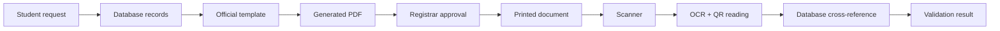
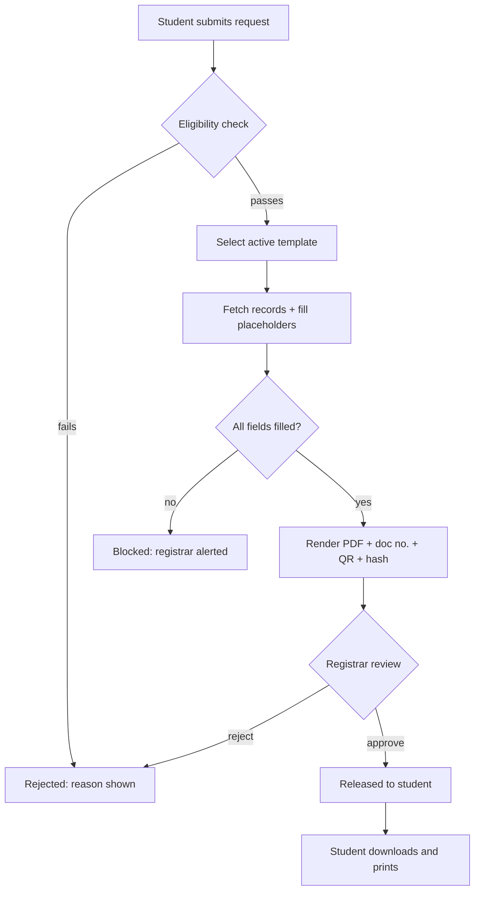
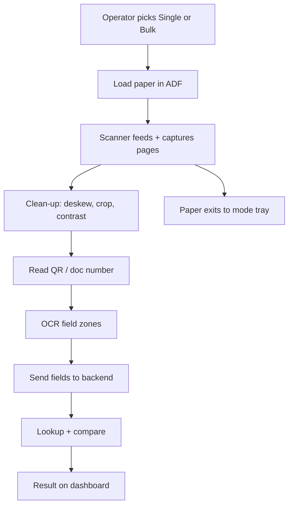
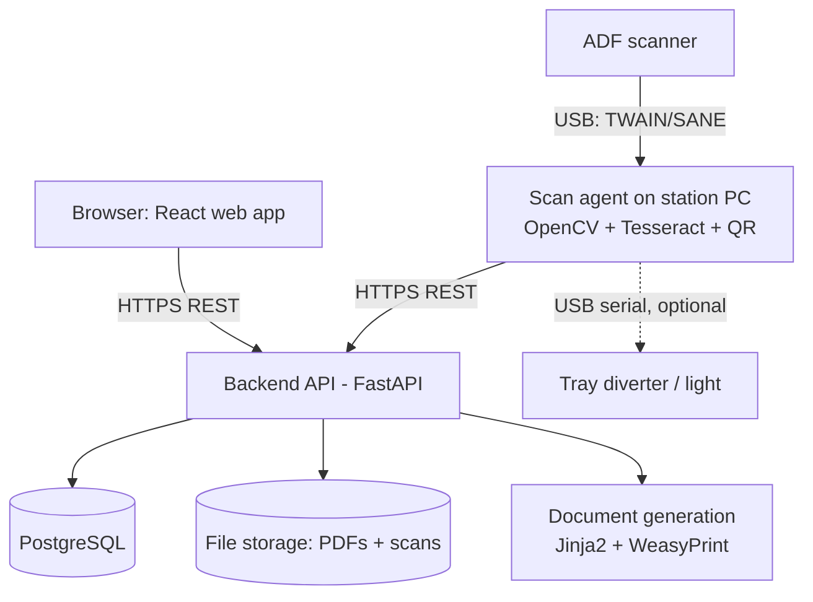
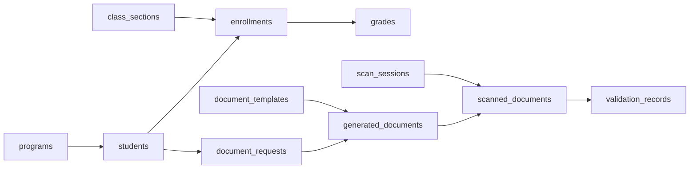
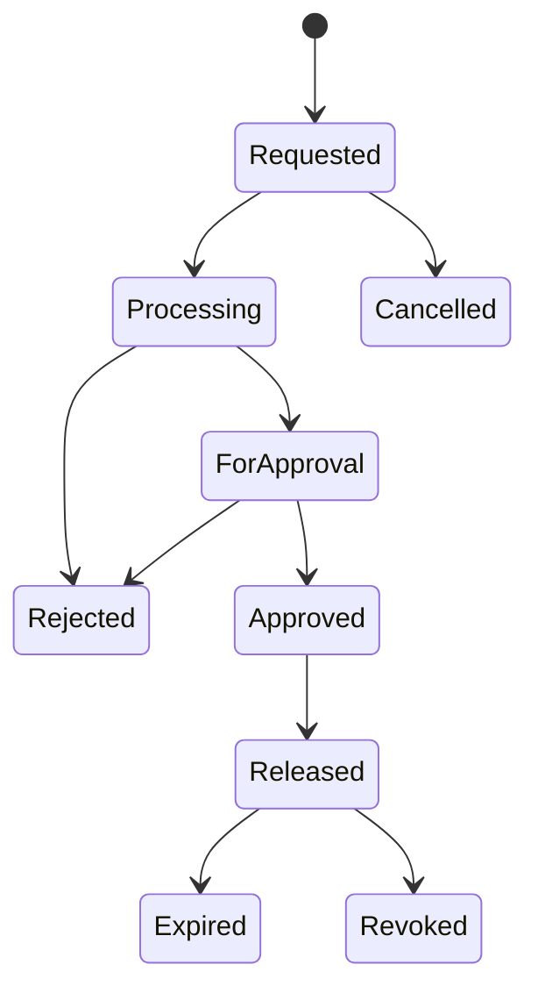
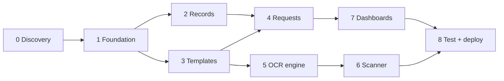

# Academic Document Generation & Validation System — MVP Specification

Sep 25, 2026

The recommended MVP is a working web system that generates academic documents from registrar-managed data, plus a scanning station that reads printed copies and checks them against the database. It proves the full loop — request, generate, print, scan, verify — for two document types (TOR and COE), using an off-the-shelf document scanner instead of custom hardware.

**Document status:** Draft for client review. Pricing and final scope depend on the answers in Section 28.

**How to read this:** Sections 1–4 and the final summaries (A–H) are written for school administrators. Sections 5–27 are the technical reference for developers. Every statement marked **\[Assumption\]** is a guess that the client must confirm.

### Key assumptions used throughout

| # | Assumption | Why it matters |
| --- | --- | --- |
| A1 | One institution, one campus, fewer than 5,000 students for the MVP. | Drives hosting size and performance targets. |
| A2 | No existing Student Information System (SIS) will be integrated in the MVP. Data is encoded or imported via CSV/Excel. | Integration with an existing SIS can double backend effort. |
| A3 | The institution will provide sample templates for each MVP document. | Templates cannot be designed without the school's official format. |
| A4 | Generated documents are printed on plain or school security paper using a normal printer. | The system does not control paper stock or printing. |
| A5 | Every generated document may carry a unique document number and a QR code. | This is the single biggest factor in validation reliability (see Section 8). |
| A6 | "Replacing CTCs" means providing a faster verification service, not a legally recognized substitute, until the institution and relevant authorities approve it. | Legal recognition is outside what software can deliver. |
| A7 | A registrar-side operator runs the scanner. Students do not use it unsupervised. | Affects hardware placement, UI, and security. |
| A8 | "Separate output chambers" is interpreted as two physical output trays (single vs. bulk), achievable with a scanner plus a simple diverter or two scanning paths. | See Section 9 for options. |

## 1. Executive Summary

**What it is.** An Academic Document Generation and Validation System: a website where students request official academic documents, and a scanning station that checks whether a printed document matches the school's official records.

**The problem it solves.** Today, staff often prepare documents such as Transcripts of Records by hand, typing data into templates. Checking whether a printed copy is genuine usually means a manual Certified True Copy (CTC) process. Both are slow and error-prone.

**Who uses it.**

- **Students** request documents and track their status online.
- **Teachers** submit and manage the grades of their classes.
- **Registrar staff** manage records and templates, approve documents, and run the scanner.

**How it works, in one line.** Student requests → system fills the official template with database records → registrar approves → student prints → printed copy is scanned → system reads it and compares it with the database → result shown on a dashboard.

**What makes it different.** A normal document management system stops once the file is released. This system also closes the loop: it can take a printed paper back and confirm whether what is printed still matches the official records. This is the core value and the main technical challenge.

**An honest limit.** The system can confirm that *the information printed matches the database*. On its own it cannot prove that *the paper was never altered or forged*. The MVP narrows that gap with a unique document number and QR code, but does not claim forensic certainty (see Section 8 and Summary H).

## 2. Problem Statement

The client has not described current pain points in detail, so every problem below is an **\[Assumption\]** based on typical Philippine school registrar operations. They must be confirmed during discovery.

| Problem area | Likely current situation \[Assumption\] | Impact |
| --- | --- | --- |
| Manual document generation | Staff copy data from records or spreadsheets into Word templates for each request. | Each document takes staff time; queues build up during enrollment and graduation. |
| Repetitive encoding | The same student data is typed into several documents and systems. | Duplicate work and inconsistent data across documents. |
| Manual template filling | Staff paste names, grades, units, and dates field by field. | High chance of misplaced or missing fields. |
| Typographical errors | Names, student numbers, and grades are retyped. | Wrong grades or names on official documents require reissuance. |
| Validating printed documents | Employers, other schools, or offices cannot easily check a printed copy. | Fake or altered documents may go unnoticed. |
| Reliance on manual CTC | Verification requires a registrar to compare the copy with the original and stamp it. | Slow, needs staff presence, and depends on visual inspection. |
| Matching paper to records | No fast way to confirm a printed grade still matches the official record. | Altered grades are hard to catch without full manual checks. |
| Time cost for all roles | Students queue and follow up; teachers submit grades in varied formats; registrars handle both. | Slow turnaround and staff overload. |

## 3. Proposed Solution

The solution has two halves that share one database: a **web application** that creates documents, and a **scanning station** that checks them.



The left half (request to printed document) is the generation side. The right half (scanner to result) is the validation side. The key link between them is the **document record**: every generated document is saved with a unique document number, the exact data printed on it, and a fingerprint (hash) of that data.

**Generation side (web application)**

1. Teachers encode grades; registrars manage student records and templates.
2. A student requests a document, such as a TOR.
3. The system checks eligibility (for example, no missing grades), pulls the data, and fills the template.
4. A PDF is produced with a document number and QR code, then queued for registrar approval.
5. Once approved, the student can download and print it (or the registrar prints it).

**Validation side (scanning station)**

1. An operator places one or more printed documents in the scanner's automatic feeder.
2. The scanner captures each page as an image.
3. The software reads the QR code and document number, then uses OCR (text recognition) to read the key printed fields.
4. It looks up the original document record and compares each field.
5. The dashboard shows VALID, INVALID, or NEEDS REVIEW, with the specific mismatched fields.

This gives the institution a verification service that is faster and more consistent than manual CTC checks, while keeping a registrar in the loop for any unclear case.

## 4. User Roles and RBAC

RBAC (Role-Based Access Control) means each user gets a role, and each role gets a fixed set of permissions. The MVP uses four roles: the three the client named, plus a **System Admin** role for account and settings management. A **Validation Operator** is treated as a permission that can be given to registrar staff, not a separate login type.

**Recommended permission model.** Templates are official institutional formats, so only the Registrar manages them. Teachers only manage grades for classes assigned to them, and only until the grading period is locked. After locking, grade changes go through a registrar-approved correction. This keeps teachers productive without letting them affect official document formats.

| Capability | Student | Teacher | Registrar | System Admin |
| --- | --- | --- | --- | --- |
| Log in / change password | Yes | Yes | Yes | Yes |
| View own profile | Yes | Yes | Yes | Yes |
| View own grades and records | Yes | — | — | — |
| Request academic documents | Yes (own only) | — | On behalf of a student | — |
| View request status and history | Own only | — | All | — |
| Download released documents | Own only | — | All | — |
| View assigned classes and students | — | Yes | All | — |
| Encode / edit grades | — | Assigned classes, before lock | All, with reason logged | — |
| Lock grading period | — | Submit for lock | Yes | — |
| Correct grades after lock | — | Request only | Approve and apply | — |
| Manage student records | — | — | Yes | — |
| Manage programs, subjects, terms | — | — | Yes | — |
| Manage document templates | — | — | Yes | — |
| Review / approve / reject requests | — | — | Yes | — |
| Release documents | — | — | Yes | — |
| Revoke an issued document | — | — | Yes | — |
| Scan and validate documents | — | — | Yes (operator permission) | — |
| Override a NEEDS REVIEW result | — | — | Yes, with remarks | — |
| View registrar dashboard and reports | — | — | Yes | Read-only |
| Manage user accounts and roles | — | — | Create students/teachers | All |
| View audit logs | — | — | Yes | Yes |
| System settings, backups | — | — | — | Yes |

**Rules that apply to every role**

- Every data query is filtered by role on the server, not just hidden in the UI.
- A student can never see another student's data, even by changing a URL.
- A teacher sees only students enrolled in their assigned class sections.
- Registrar actions that change official records always require a reason, which is logged.

**\[Assumption\]** Some schools want a Dean or Department Head to approve documents. The MVP supports one approval step (Registrar). Multi-step approval is Phase 2.

## 5. Core MVP Features

Thirteen modules make up the MVP. Each lists its purpose, users, inputs, outputs, and the minimum the MVP must do. Anything not listed under "MVP requirements" belongs to Phase 2 (Section 20).

### A. Authentication & RBAC

- **Purpose:** Let only authorized people in, and limit what each can do.
- **Main functions:** Login, logout, password reset, role assignment, session timeout, account lockout.
- **Primary users:** All.
- **Inputs:** Email or ID number, password.
- **Outputs:** Authenticated session with role permissions.
- **MVP requirements:** Hashed passwords (bcrypt/argon2); 4 roles; server-side permission checks on every API route; lockout after 5 failed attempts; 30-minute idle timeout; forced password change on first login. Password reset by registrar/admin in MVP (email reset is Phase 2 if no mail server is available).

### B. Student Management

- **Purpose:** Maintain the official student master list.
- **Main functions:** Add, edit, deactivate students; bulk import from CSV/Excel; search.
- **Primary users:** Registrar.
- **Inputs:** Student number, full name, birthdate, program, year level, status, contact details.
- **Outputs:** Student profiles used by every document.
- **MVP requirements:** CRUD with validation (unique student number, required fields); CSV import with an error report per row; name fields stored separately (first, middle, last, suffix) so templates format them consistently.

### C. Academic Records

- **Purpose:** Hold the grades and enrollment data that documents are built from.
- **Main functions:** Manage programs, subjects, terms, class sections, enrollments, and grades; lock grading periods.
- **Primary users:** Teacher (grades for own classes), Registrar (everything).
- **Inputs:** Subject codes, units, terms, section assignments, grades.
- **Outputs:** Complete, locked academic history per student.
- **MVP requirements:** Grade entry per class section; grade import from CSV; grading scale configurable (e.g. 1.00–5.00, INC, DRP); lock per term; any edit after lock requires registrar approval and a reason; computed GWA per term.

### D. Document Template Management

- **Purpose:** Store the official layout of each document with placeholders.
- **Main functions:** Upload template, preview with sample data, activate/retire versions.
- **Primary users:** Registrar.
- **Inputs:** Template file (HTML-based, see Section 13), document type, placeholder list.
- **Outputs:** Versioned, active template per document type.
- **MVP requirements:** One active version per document type; placeholder check before activation (unknown or missing placeholders block activation); sample-data preview; old versions kept read-only.

### E. Academic Document Request

- **Purpose:** Let students ask for documents online.
- **Main functions:** Choose document type, purpose, number of copies; submit; cancel; track status.
- **Primary users:** Student; Registrar (on behalf of walk-ins).
- **Inputs:** Document type, purpose (e.g. employment, transfer), copies, remarks.
- **Outputs:** Request record with a reference number and status.
- **MVP requirements:** Eligibility check at submission (active record, no missing/INC grades for TOR, currently enrolled for COE); duplicate pending request blocked; status visible on student dashboard. Payment is **out of MVP scope** — registrar marks "payment confirmed" manually if the school charges fees.

### F. Automated Document Generation

- **Purpose:** Produce the document file with no manual typing.
- **Main functions:** Fetch data, fill template, add document number, QR code and data hash, render PDF.
- **Primary users:** System (triggered by request or registrar).
- **Inputs:** Request, student data, active template.
- **Outputs:** PDF file plus a saved snapshot of all printed values.
- **MVP requirements:** Generation in under 10 seconds per document; stored data snapshot (JSON) of exactly what was printed; unique document number (e.g. `TOR-2026-000123`); QR code containing a verification token; SHA-256 hash of the snapshot; PDF stored in protected storage.

### G. Document Approval

- **Purpose:** Keep a human in control before anything is official.
- **Main functions:** Preview, approve, reject with reason, regenerate, release, revoke.
- **Primary users:** Registrar.
- **Inputs:** Generated document, approval decision, remarks.
- **Outputs:** Approved and released document, or rejection notice to student.
- **MVP requirements:** Side-by-side preview of PDF and source data; approve/reject with mandatory reason on reject; only approved documents become downloadable and verifiable; revocation marks the document invalid for future scans.

### H. Document History / Audit Trail

- **Purpose:** Record who did what and when.
- **Main functions:** Log events; filter and search logs; view a document's full history.
- **Primary users:** Registrar, System Admin.
- **Inputs:** System events.
- **Outputs:** Append-only log entries.
- **MVP requirements:** Logs for events listed in Section 17; logs cannot be edited or deleted through the application; per-document timeline view.

### I. Document Scanning

- **Purpose:** Capture printed documents as images.
- **Main functions:** Start single or bulk scan session; receive images from scanner; group pages into documents.
- **Primary users:** Registrar / operator.
- **Inputs:** Paper documents in the feeder.
- **Outputs:** 300 DPI page images linked to a scan session.
- **MVP requirements:** Scanner connected to a station PC; single mode (one document) and bulk mode (a stack); pages grouped by the QR code/document number found on each first page; scan images stored with the session.

### J. OCR / Information Extraction

- **Purpose:** Turn page images into field values.
- **Main functions:** Image clean-up, QR decoding, OCR, field extraction by template zones.
- **Primary users:** System.
- **Inputs:** Page images, template version's field map.
- **Outputs:** Extracted fields with confidence scores.
- **MVP requirements:** Deskew and contrast clean-up (OpenCV); QR decode; Tesseract OCR on defined zones (name, student number, document number, date issued, and the grades table); per-field confidence score; printed text only (no handwriting).

### K. Database Cross-Reference

- **Purpose:** Find the original record and compare.
- **Main functions:** Look up by QR token or document number; compare each field with the stored snapshot and the current records.
- **Primary users:** System.
- **Inputs:** Extracted fields.
- **Outputs:** Field-by-field match report.
- **MVP requirements:** Exact match for IDs and document numbers; normalized match for names (case, spacing, ñ/Ñ); numeric match for grades; flag if the document was revoked or if official records have changed since issue.

### L. Document Validation

- **Purpose:** Turn the match report into a clear decision.
- **Main functions:** Apply rules; set VALID / INVALID / NEEDS REVIEW; let a registrar resolve reviews.
- **Primary users:** System; Registrar for reviews.
- **Inputs:** Match report, confidence scores, document status.
- **Outputs:** Validation record with result, reasons, and scan images.
- **MVP requirements:** Rules exactly as in Section 15; every result saved with reasons; registrar can resolve NEEDS REVIEW with remarks (the original automated result is kept).

### M. Validation Dashboard

- **Purpose:** Show scan results clearly to the operator and summary numbers to the registrar.
- **Main functions:** Live result screen, scan history, per-field mismatch view, counts.
- **Primary users:** Registrar / operator.
- **Inputs:** Validation records.
- **Outputs:** Screens described in Section 16.
- **MVP requirements:** Result shown within 15 seconds of the page leaving the scanner; large color-coded status; list of mismatched fields with printed vs. official values; filter history by date and result.

## 6. Academic Document Generation Workflow

Generation is automatic; release is not. A registrar approves every document before it becomes official.



The diagram reads top to bottom; diamonds are decision points.

| Step | What happens | Automatic or manual |
| --- | --- | --- |
| 1. Request | Student picks document type, purpose, and copies. | Manual (student) |
| 2. Eligibility check | System checks student status, missing/INC grades, locked terms, holds. | Automatic |
| 3. Payment confirmation | Only if the school charges a fee; registrar ticks "paid". | Manual (registrar) — optional |
| 4. Template selection | System picks the active template version for the document type. | Automatic |
| 5. Data retrieval | System pulls student, program, enrollment, and grade data. | Automatic |
| 6. Template population | Placeholders are replaced with values; tables are built (e.g. grades per term). | Automatic |
| 7. Completeness check | Any empty required field stops generation. | Automatic |
| 8. Rendering | PDF produced with document number, QR code, and data hash; snapshot saved. | Automatic |
| 9. Review | Registrar compares PDF with source data, then approves or rejects. | Manual (registrar) |
| 10. Release | Document becomes downloadable and verifiable. | Automatic on approval |
| 11. Printing | Student or registrar prints the PDF. | Manual |

**Signatures.** **\[Assumption\]** For the MVP, the template includes a printed name and title of the signatory, and the registrar may sign the printed copy by hand. An image of a signature on the template is possible but adds little security, since it is easily copied. Digital (cryptographic) signatures on the PDF are Phase 2.

**Who prints.** The client must decide whether students print their own copies or the registrar prints on security paper. Registrar printing gives more control and is recommended for TORs (see Section 28).

## 7. Document Types

The MVP should build two documents well — **TOR** and **COE** — rather than five documents partially. TOR is the hardest (multi-page, many grades) and proves the system works; COE is simple and high-volume.

| Document | MVP? | Data required | Template-based? | Validation method |
| --- | --- | --- | --- | --- |
| TOR (Transcript of Records) | **Yes** | Student info, program, all terms, subjects, units, final grades, GWA, date issued, remarks | Yes, multi-page with a repeating grades table | QR/doc number lookup + OCR of identity fields and full grades table vs. snapshot |
| COE (Certificate of Enrollment) | **Yes** | Student info, program, year level, current term, date issued, purpose | Yes, single page | QR/doc number lookup + OCR of name, student number, term, date |
| COG (Certificate of Grades) | Phase 2 (easy add) | Student info, one term's subjects, units, grades, GWA | Yes, single page | Same method as TOR, one term |
| COR (Certificate of Registration) | Phase 2 | Enrolled subjects, schedule, sections, assessed fees | Yes | Same method; depends on enrollment/fees data the MVP may not hold |
| Diploma | Out of MVP; Phase 2 with conditions | Name, degree, honors, graduation date, board resolution/SO number | Usually pre-printed on special paper | QR/doc number only; decorative layout and scripts make OCR unreliable |

**Why these choices**

- **COG** reuses the TOR engine with a single-term filter. It can be added quickly once TOR works, so it is a good first Phase 2 item.
- **COR** needs schedules and fee assessment. **\[Assumption\]** The MVP does not include an enrollment or billing module, so COR waits until that data exists or an SIS integration is in place.
- **Diploma** is usually printed on special stock, signed by several officials, and tied to graduation approvals and, for some programs, CHED Special Order numbers. It is a ceremonial and legal document; automating it adds approval complexity with little demo value. Adding a QR code to diplomas later is still a strong idea.

**Explicitly out of scope:** government or personal documents (birth certificates, NBI/police clearances, PSA records), good moral certificates, honorable dismissal/transfer credentials, payment receipts, and ID cards — unless the institution specifically asks for them in a later phase.

## 8. Document Validation Architecture

The MVP validates in three layers: a **QR/document-number lookup** (Level 0), **field-by-field data comparison** (Level 1), and **basic layout checks** (Level 2, limited). True forgery detection — proving the paper itself is untouched — is not realistic for an MVP and is not promised.

### Why OCR alone cannot prove authenticity

OCR (Optical Character Recognition) reads printed letters from an image. It answers "what does this paper say?", not "who printed this paper?". Anyone who knows a student's real data can type it into a fake document that will pass an OCR-only check. And OCR makes reading mistakes (for example, reading 1.25 as 1.26), so a mismatch may be an OCR error rather than tampering. That is why the design leans on the document number and QR code, and why a NEEDS REVIEW result exists.

### Level 0 — Document identity (QR code + document number)

Every generated document carries a unique document number and a QR code. The QR holds a random verification token (not personal data). At scan time:

1. The system decodes the QR code. If unreadable, it OCRs the printed document number instead.
2. It looks up the issued-document record.
3. It checks status: must be **Released** and not **Revoked**.

If no record exists, the document was not issued by this system → INVALID. This single step stops most fabricated documents, because a forger cannot create a valid token that exists in the database.

### Level 1 — Data validation

The system OCRs the key printed fields and compares them with the **snapshot saved at issue time** (what was actually printed), and also with the **current official records** (to catch later grade corrections).

| Field | Where read from | Comparison rule | Criticality |
| --- | --- | --- | --- |
| Document number | QR + OCR | Exact | Critical |
| Student number | OCR zone | Exact after removing spaces/dashes | Critical |
| Student name | OCR zone | Normalized (case, spacing, accents, ñ). Exact after normalizing = match; 90–99% similar = review; below 90% = mismatch | Critical |
| Program / course | OCR zone | Normalized text | Important |
| Subject codes | OCR table | Exact per row | Important |
| Grades | OCR table | Exact numeric per row | Critical |
| Units | OCR table | Exact numeric | Important |
| Academic year / term | OCR zone | Exact | Important |
| GWA | OCR zone | Exact to 2 decimals | Important |
| Date issued | OCR zone | Exact date | Important |
| Data hash (short form printed in footer) | OCR | Exact vs. stored hash | Supporting |

**Two comparisons, two meanings**

- Printed value ≠ snapshot → the paper differs from what was issued (possible alteration or OCR error).
- Snapshot ≠ current records → the paper was genuine when issued but records were corrected later. Result: NEEDS REVIEW with note "record updated since issue".

### Level 2 — Document / visual validation

| Check | MVP? | Realistic approach |
| --- | --- | --- |
| Page layout matches template version | Yes (basic) | Detect page borders and compare key anchor positions (header, QR, table start) against the template's expected zones |
| QR present and in expected position | Yes | Part of Level 0 |
| School logo present | Yes (basic) | Template matching (OpenCV) in the header zone: present / not present |
| Header and footer text | Yes | OCR the header/footer and compare to template text |
| Page count matches issued record | Yes | Compare pages scanned vs. pages issued (catches missing TOR pages) |
| Signature authenticity | No — Phase 2+ | Only "signature area not blank" is feasible; verifying a real signature needs specialized models and reference samples |
| Stamp / dry seal recognition | No — Phase 2+ | Dry seals barely show on scans; ink stamps vary with every press |
| Security paper patterns / watermarks | No — Out of scope | Needs UV/IR scanning hardware |
| Detecting erasures, overprints, digital edits | No — Phase 2+ | Needs image forensics and training data |
| ML anomaly detection | No — Phase 2+ | Needs a large set of genuine and fake samples |

### What the result means

- **VALID** = this document number was issued by the institution, is still active, and the key printed information matches the official record.
- It does **not** mean a forensic lab examined the paper. A perfect photocopy of a genuine document will also be VALID — which is acceptable, because its information is true.

The strongest future upgrade is a **digitally signed QR code** (the QR contains the key data signed with the school's private key). Then even offline verification with a phone is trustworthy. This is recommended for Phase 2 (Section 20).

## 9. Scanner/Hardware MVP

Build the station from an off-the-shelf **ADF (automatic document feeder) sheet-fed scanner** connected to a **mini PC**, with a simple add-on for the two output trays. Do not build a custom paper-feeding mechanism: commercial feeders already solve jams, double-feeds, and paper alignment far better than a prototype can.

### Components

| Component | Recommended option | Role |
| --- | --- | --- |
| Paper input | Scanner's built-in ADF tray (typically 20–100 sheets) | Holds single or stacked documents |
| Automatic feeder | Built into the scanner | Pulls one sheet at a time, detects double-feeds |
| Scanner | Sheet-fed duplex document scanner, ≥ 25 pages/min, 300 DPI, TWAIN/SANE or vendor SDK support | Captures page images |
| Processing computer | Mini PC (Intel i5-class or Ryzen, 16 GB RAM, SSD, Windows or Linux) | Runs the scan agent, image clean-up, OCR, QR reading |
| Output handling | Two trays: see options below | Separates single vs. bulk outputs |
| Dashboard display | Monitor on the mini PC (or 10–15" touchscreen) | Shows live results; runs the web dashboard in a browser |
| Result indicator (optional) | USB light (green/red/amber) | Instant visual result without reading the screen |
| Network | Wired Ethernet to school LAN | Talks to the backend server over HTTPS |

**Why a mini PC, not a Raspberry Pi.** OCR on a full TOR page takes several seconds even on a laptop-class CPU. A Raspberry Pi would be 3–5× slower, and many document scanners lack drivers for its ARM processor. A mini PC costs somewhat more but removes both risks. A Raspberry Pi (or microcontroller such as an Arduino/ESP32) is useful only for the optional tray diverter below.

### Interpreting "separate output chambers"

The client's wording can mean two things. This must be confirmed (Section 28).

| Option | What it is | Effort | Recommendation |
| --- | --- | --- | --- |
| 1. Separate output modes (software only) | Single and bulk are separate scan modes with separate result screens and reports; paper exits to the scanner's normal tray | Lowest | Fallback if budget is tight |
| 2. Two physical trays, operator-directed | Enclosure has two labeled trays; the dashboard tells the operator which tray to place the stack in when done, or the scanner's output is angled to one of two trays by a manual flap | Low | **Recommended for MVP** |
| 3. Two physical trays, automatic diverter | A servo-driven flap after the scanner exit, controlled by a microcontroller, routes paper to the single or bulk tray based on scan mode | Medium | Optional MVP add-on if the client insists on automation |
| 4. Sorting by result (valid vs. invalid) | Diverter routes each sheet by its validation result | High — result may not be ready before the sheet exits | Phase 2 |

Option 3 is feasible because the tray is chosen by **mode** (known before scanning), not by **result**. Sorting by result (Option 4) requires the system to finish OCR before the paper leaves the scanner, which commercial scanners don't allow.

### Who does what

| Layer | Responsibilities |
| --- | --- |
| Scanner hardware | Feed paper, detect double-feeds and jams, capture images, eject paper |
| Station computer (scan agent) | Control scanning via TWAIN/SANE; group pages into documents; image clean-up; QR decode; OCR; send results and images to the backend; control optional diverter/light |
| Backend server | Look up document records; compare fields; decide result; store validation records and images; write audit logs |
| Web application | Operator dashboard, history, review screen, registrar reports |

**Design choice:** OCR runs on the station, not the server, so scan images do not need to travel across the network before processing and the server stays light. **\[Assumption\]** If the school prefers one central server with more power, OCR can move there without changing the rest of the design.

### Single vs. bulk scanning

- **Single mode:** Operator places one document (one or more pages). The system shows one large result. Paper goes to the single tray.
- **Bulk mode:** Operator places a stack (e.g. 30 documents from an employer's batch). The system splits the stack into documents using the QR code on each document's first page (and a page-number marker on each page), processes them in a queue, and shows a summary table: total, valid, invalid, needs review. Paper goes to the bulk tray. The summary can be exported to CSV/PDF.

## 10. Hardware Workflow

A single document goes from feeder to result in about 10–15 seconds; a bulk stack scans at scanner speed and is validated in a queue behind it.



Paper leaves the scanner while processing continues, so the output tray is set by mode, not by result.

**Single-document flow**

1. Operator selects **Single** on the dashboard (diverter, if fitted, moves to the single tray).
2. Operator inserts the document into the feeder and presses Scan (or the scanner auto-starts on paper detection).
3. Pages are captured at 300 DPI, grayscale.
4. The scan agent cleans each image: straighten, crop borders, boost contrast.
5. The QR code is decoded; if unreadable, the printed document number is read by OCR.
6. The agent loads that template version's field zones and OCRs each zone.
7. Extracted fields and confidence scores are sent to the backend with the images.
8. The backend compares and returns VALID, INVALID, or NEEDS REVIEW.
9. The dashboard shows the result (and the optional light turns green/red/amber).
10. Operator removes the paper from the single tray.

**How bulk differs**

- Operator selects **Bulk** and loads a stack; the scanner runs without stopping.
- Every page is captured first, then split into documents: a new document starts at each page carrying a first-page QR. Continuation pages carry "Page X of Y" plus the document number, so missing or misordered pages are detected.
- Documents are validated in a queue; the dashboard fills a results table live.
- A jam or double-feed pauses the batch; the operator re-feeds from the failed sheet and the system continues the same session.
- At the end, a batch summary (counts + list of non-VALID documents) is shown and can be exported. Operator pulls the flagged documents from the bulk tray by their position number in the list.

**\[Assumption\]** Bulk capacity for the MVP: up to 50 sheets per load, matching common ADF capacity. Larger batches are loaded in several runs within one session.

## 11. System Architecture

Recommended stack: **React + Tailwind** frontend, **Python (FastAPI)** backend, **PostgreSQL** database, and a **Python scan agent** on the station PC. Using Python for both the backend and the scanning side means one language for all document and image work.



All parts talk through one REST API; the station is just another authenticated client.

| Layer | Recommended technology | Reason |
| --- | --- | --- |
| Frontend | React (Vite) + Tailwind CSS + a component kit (e.g. shadcn/ui) | Fast to build dashboards and forms; large talent pool in PH |
| Backend API | Python 3.12 + FastAPI + SQLAlchemy + Alembic | Automatic API docs; same language as OCR/PDF libraries; simple to maintain |
| Database | PostgreSQL 16 | Strong data integrity, JSONB for document snapshots, free |
| Authentication | JWT in httpOnly cookies, or server sessions; argon2 password hashing | Standard and secure for a single web app |
| Document generation | HTML templates (Jinja2) → PDF via WeasyPrint | Registrars can edit HTML/CSS templates; handles multi-page tables with repeated headers |
| QR code | `qrcode` (Python) to create; `pyzbar`/OpenCV to read | Mature, free |
| OCR | Tesseract 5 via `pytesseract` | Free, offline, accurate on clean printed text; no student data sent to cloud |
| Image processing | OpenCV | Deskew, crop, contrast, logo template-matching |
| Scanner control | TWAIN (Windows) or SANE (Linux) via Python wrappers, or vendor SDK | Works with most commercial ADF scanners |
| File storage | Local disk on server with restricted access (S3-compatible such as MinIO optional) | Simple for one campus |
| Background jobs | Simple task queue (RQ or Celery with Redis) | PDF generation and bulk validation run without freezing the UI |
| Deployment | Docker Compose on one on-premise or cloud server; Nginx reverse proxy with HTTPS | One-command setup; easy to move between servers |

**Alternatives considered**

- **Node.js backend:** Fine for the web app, but OCR and image work would still need Python, giving two backend languages. Choose Node only if the team is much stronger in it.
- **MySQL:** Acceptable if the school's IT prefers it; PostgreSQL is preferred for JSONB snapshots.
- **DOCX templates** (e.g. docxtpl): Easier for registrars who only know Word, but converting to PDF reliably needs LibreOffice on the server. Offered as a fallback (Section 13).
- **Cloud OCR** (Google Vision, AWS Textract): More accurate on poor scans, but sends student records to a third party and adds ongoing cost. Not recommended for the MVP due to privacy.

**Hosting.** **\[Assumption\]** One server (4 vCPU, 8 GB RAM, 200 GB SSD) either on the school network or with a cloud provider in or near the Philippines. The client's IT policy decides which (Section 28).

## 12. Database Schema

The MVP needs 17 tables. Two suggested tables are merged away: **roles** is a fixed column on users (four roles don't need a table), and **document\_versions** is replaced by storing template versions and one issued-document record per generation (a regenerated document gets a new number). A **terms** and **class\_sections** table are added because grades belong to a class in a specific term.

| Entity | Purpose | Important fields | Relationships |
| --- | --- | --- | --- |
| users | Login accounts | id, email, password\_hash, role (student/teacher/registrar/admin), is\_active, can\_validate, last\_login\_at, failed\_logins | 1–1 students or teachers (optional) |
| students | Official student master data | id, user\_id, student\_number (unique), first/middle/last\_name, suffix, birthdate, sex, program\_id, year\_level, status (active/graduated/inactive), admission\_date | → users, → programs |
| teachers | Faculty profile | id, user\_id, employee\_number, full name, department | → users |
| programs | Degree programs | id, code (e.g. BSIT), name, department, total\_units | ← students, ← curriculum subjects |
| subjects | Course catalog | id, code, title, units, program\_id (nullable for general ed) | ← class\_sections |
| terms | Academic periods | id, academic\_year (2025-2026), semester (1st/2nd/Summer), is\_grades\_locked | ← class\_sections |
| class\_sections | A subject taught in a term | id, subject\_id, term\_id, section\_code, teacher\_id | → subjects, → terms, → teachers |
| enrollments | Student in a class section | id, student\_id, class\_section\_id, status (enrolled/dropped) | → students, → class\_sections; 1–1 grades |
| grades | Final grade per enrollment | id, enrollment\_id, grade\_value, remarks (Passed/Failed/INC/DRP), encoded\_by, is\_locked, updated\_at | → enrollments |
| grade\_change\_requests | Corrections after lock | id, grade\_id, old\_value, new\_value, reason, requested\_by, approved\_by, status | → grades, → users |
| document\_templates | Template versions | id, document\_type (TOR/COE), version, html\_content, placeholder\_list (JSON), field\_zones (JSON for OCR), status (draft/active/retired), created\_by | ← generated\_documents |
| document\_requests | Student requests | id, reference\_no, student\_id, document\_type, purpose, copies, status, requested\_at, reviewed\_by, reject\_reason | → students; 1–many generated\_documents |
| generated\_documents | Each issued file | id, document\_number (unique), request\_id, template\_id, data\_snapshot (JSONB), data\_hash (SHA-256), qr\_token (unique, random), pdf\_path, page\_count, status (generated/approved/released/revoked), approved\_by, released\_at, revoked\_reason | → document\_requests, → document\_templates |
| scan\_sessions | One single or bulk scanning run | id, mode (single/bulk), operator\_id, station\_id, started\_at, ended\_at, total\_docs | → users; 1–many scanned\_documents |
| scanned\_documents | One physical document scanned | id, session\_id, image\_paths (JSON), matched\_document\_id (nullable), extracted\_fields (JSONB), ocr\_confidence | → scan\_sessions, → generated\_documents |
| validation\_records | Result per scanned document | id, scanned\_document\_id, result (VALID/INVALID/NEEDS\_REVIEW), field\_results (JSONB), reasons, final\_result, reviewed\_by, review\_remarks | → scanned\_documents, → users |
| audit\_logs | Append-only activity log | id, timestamp, user\_id, action, entity\_type, entity\_id, old\_value (JSON), new\_value (JSON), ip\_address | → users |

**Relationship overview (ERD in words)**

- A **user** is either a student, a teacher, or staff (registrar/admin, no profile table).
- A **student** belongs to one **program** and has many **enrollments**.
- A **class\_section** is one **subject** in one **term**, taught by one **teacher**, with many enrollments.
- Each **enrollment** has one **grade**; a grade may have many **grade\_change\_requests**.
- A **student** makes many **document\_requests**; each request produces one or more **generated\_documents** (e.g. after a rejection and regeneration).
- Each **generated\_document** uses exactly one **document\_template** version and stores a frozen **data\_snapshot** of what was printed.
- A **scan\_session** contains many **scanned\_documents**; each is linked to the **generated\_document** it claims to be (if found) and has one **validation\_record**.
- **audit\_logs** reference any entity by type and id.



Arrows point from "one" to "many". Users, teachers, subjects, terms, grade\_change\_requests, and audit\_logs are left off the diagram for readability.

**Key constraints:** unique student\_number, document\_number, and qr\_token; a grade cannot change when its term is locked except through an approved grade\_change\_request; generated\_documents.data\_snapshot is never updated after approval.

## 13. Document Template System

Templates are HTML/CSS files with `{{placeholders}}`, stored as versioned records in the database. The development team converts the school's current Word/PDF formats into the first templates; the registrar then manages versions through the web app.

**How templates are stored.** Each version is a row in `document_templates` holding the HTML, its placeholder list, and its OCR field-zone map. Uploaded images (logo, header art) are embedded or stored alongside. **\[Assumption\]** Registrars will not hand-code HTML; the MVP provides an upload screen plus a live preview, and developers do the first conversion. A visual template editor is Phase 2.

**Placeholder catalog.** Only placeholders from a fixed, documented catalog are allowed:

| Placeholder | Source | Example |
| --- | --- | --- |
| `{{student_name}}` | students first + middle initial + last + suffix | JUAN D. DELA CRUZ JR. |
| `{{student_number}}` | students.student\_number | 2021-00123 |
| `{{program}}` | programs.name | Bachelor of Science in Information Technology |
| `{{year_level}}` | students.year\_level | 3rd Year |
| `{{semester}}` / `{{academic_year}}` | terms | 1st Semester / 2025-2026 |
| `{{date_issued}}` | generation date | September 25, 2026 |
| `{{document_number}}` | generated | TOR-2026-000123 |
| `{{qr_code}}` | generated image | QR image |
| `{{gwa}}` | computed from grades | 1.75 |
| `{{purpose}}` | document\_requests.purpose | Employment |
| `{{#each terms}} … {{#each subjects}} {{subject_code}} {{subject_title}} {{units}} {{grade}} {{/each}} {{/each}}` | enrollments + grades | Repeating grades table for TOR |

**Mapping to the database.** A mapping file in the code (not in the template) connects each placeholder to a query or computation. Templates never contain database queries. This keeps templates safe to edit and the data logic testable.

**Preventing missing fields**

1. **At upload:** the system scans the template for placeholders. Any unknown placeholder, or a missing required one (e.g. a TOR without `{{document_number}}` or `{{qr_code}}`), blocks activation.
2. **At preview:** the registrar sees the template filled with sample data before activating.
3. **At generation:** if any required value is empty for the student (e.g. no program), generation stops and the request is flagged for the registrar. No document is ever produced with a blank field.

**Versioning**

- Each change creates a new version (v1, v2…). Only one version per document type is **active**.
- Activating a new version retires the old one for **new** documents only.
- Every generated document permanently records which template version it used.

**What happens when a template changes.** Documents already issued are unaffected. They stay valid, and the scanner uses the **field-zone map of the version they were printed with**. This is why OCR zones are stored per version. A registrar must re-draw or confirm the OCR zones whenever a new version changes the layout; the system blocks activation until zones are defined.

**Fallback option:** If the registrar strongly prefers Word, the system can accept DOCX templates (docxtpl syntax) and convert to PDF with LibreOffice. This adds conversion risk and is not recommended as the default.

## 14. Document Request Lifecycle

A request moves through six main statuses; three end states cover rejection, cancellation, and expiry.



"Generated" is folded into Processing → For Approval because generation takes seconds and is automatic.

| Status | Meaning | Who/what sets it |
| --- | --- | --- |
| Requested | Student submitted; awaiting checks (and payment, if any) | Student |
| Processing | Eligibility passed; document being generated | System (or Registrar confirming payment) |
| For Approval | PDF generated and waiting for registrar review | System |
| Approved | Registrar accepted the document | Registrar |
| Released | Available for download/printing and verifiable by scan | System on approval, or Registrar if release is manual (e.g. pickup) |
| Rejected | Not eligible, or registrar rejected; reason is required and shown to student | System (eligibility) or Registrar |
| Cancelled | Student withdrew before processing | Student (only while Requested) |
| Expired | Download window closed (e.g. 30 days) | System, scheduled |
| Revoked | Issued document declared invalid (error found, fraud) | Registrar only, with reason |

> **Change (Annex A, S-11/S-08, pending client signature).** Per the client's Updated Features II-B, the registrar approves the **request before** information retrieval and document generation: Requested (shown to students as *Pending*) → registrar approves or rejects with a reason → records retrieved and document generated → *For Verification* (registrar checks the generated document side by side, may send it back for regeneration with a new document number) → *Verified* (only when release is manual) → *Released* (shown as *Completed*). *Processing* and *For Approval* are retired; *Approved* now means "request approved". Students see Pending / Approved / Rejected / Completed (plus Cancelled, Expired, Revoked). Eligibility, payment, snapshot immutability and numbering rules are unchanged. S-08 adds one class adviser per block section (term + section code), who may view that class's rosters and grades read-only.

**Important distinction:** *Expired* only ends the student's download access. The document remains **valid** for scanning. *Revoked* makes future scans return INVALID. **\[Assumption\]** A 30-day download window; the institution may also want issued documents to have a validity period for scanning (Section 28).

## 15. Validation Result

Every scan ends in one of three results. The wording on screen is deliberately careful: VALID means "matches official records", never "100% authentic".

| Result | Rule (all conditions evaluated in order) | Dashboard message |
| --- | --- | --- |
| **INVALID** (red) | Any of: no matching document number/QR in the database; document is Revoked; a critical field (student number, name, grade, document number) clearly mismatches with high OCR confidence (≥ 90%); page count differs from issued record | "Does not match official records." + list of failing fields |
| **NEEDS REVIEW** (amber) | Document found and not revoked, but any of: OCR confidence below 90% on a critical field; name similarity 90–99%; official record changed since issue; QR unreadable and document number read only by OCR; logo/layout check failed; important (non-critical) field mismatch | "Could not fully verify — registrar review needed." + reason |
| **VALID** (green) | Document found, Released, not revoked; all critical and important fields match with confidence ≥ 90%; layout checks pass | "Information matches official records as of \[date/time\]." |

**What the operator sees for each field:** field name, value read from paper, official value, match/mismatch, and confidence. Mismatched fields are highlighted, and the relevant crop of the scan image is shown next to them so a person can judge quickly.

**Review handling.** A registrar can resolve NEEDS REVIEW to Confirmed Valid or Confirmed Invalid with remarks. The system keeps both the automatic result and the human decision.

**Standard footer on every result:** "This verification confirms that the printed information matches the institution's records. It does not certify the physical integrity of the paper."

**\[Assumption\]** The 90% thresholds are starting values; they will be tuned during testing with real scans (Section 27).

## 16. Dashboard

Three dashboards cover the MVP: Registrar (overview), Student (my requests), and Validation Operator (live scanning). All counts can be filtered by date range.

### Registrar dashboard

| Widget | Content |
| --- | --- |
| Request summary cards | Total, pending (Requested + Processing), for approval, approved/released, rejected — today, this week, this month |
| Approval queue | Oldest-first list of documents awaiting review, with one-click preview |
| Documents generated | Count by type (TOR, COE) per month, as a bar chart |
| Validation summary | Documents scanned; valid / invalid / needs review counts and percentages |
| Needs review queue | Scans awaiting a human decision |
| Data health | Students with missing grades or incomplete profiles that will block requests |
| Recent activity | Last 20 audit events |

### Student dashboard

| Widget | Content |
| --- | --- |
| New request button | Shows only document types the student is eligible for |
| My requests | Reference number, type, date, current status, reject reason if any |
| Released documents | Download buttons with expiry date |
| History | Past requests and download log (when each document was downloaded) |
| My records | Read-only view of profile and grades, so errors are spotted before requesting |

### Validation operator dashboard

| Widget | Content |
| --- | --- |
| Mode selector | Single / Bulk, plus scanner connection status (ready, jam, offline) |
| Live result panel | Large VALID / INVALID / NEEDS REVIEW badge, student name, document type and number |
| Field comparison | Paper value vs. official value per field, mismatches highlighted, with image crops |
| Bulk batch table | Position in stack, document number, result, top reason; running totals |
| Recent scans | Last 50 scans with filters by result, type, date |
| Failed-field breakdown | Which fields fail most often (helps spot OCR problems vs. real tampering) |
| Export | Batch or date-range results to CSV/PDF |

## 17. Audit Trail

Every action that creates, changes, releases, or checks an official record is logged, with who, what, when, from where, and the before/after values. Logs are append-only: no one, including admins, can edit or delete them through the application.

| Category | Events logged |
| --- | --- |
| Access | Login success/failure, logout, lockout, password change/reset |
| Accounts | User created, role changed, deactivated |
| Student records | Created, edited (field-level old/new), imported (file name, row count) |
| Grades | Encoded, edited before lock, term locked, change requested, change approved/rejected |
| Templates | Uploaded, previewed, activated, retired |
| Requests | Submitted, cancelled, eligibility result, payment confirmed |
| Documents | Generated, approved, rejected, released, downloaded, revoked |
| Scanning | Session started/ended, document scanned, result produced, review decision |
| System | Backups run, settings changed, scan station registered |

**Why it matters**

- **Accountability:** if a wrong grade appears on a TOR, the log shows who changed it, when, and why.
- **Fraud investigation:** revoked or suspicious documents can be traced from request to scan.
- **Trust in validation:** a VALID result is only meaningful if the underlying records cannot be quietly changed.
- **Privacy obligations:** the Data Privacy Act expects institutions to know who accessed personal data.

**MVP implementation:** a single `audit_logs` table written by the backend on every relevant action; the application database user has insert-only rights on it. Logs are retained for at least the full MVP pilot; the long-term retention period is for the client to set.

## 18. Security and Data Privacy

The MVP includes standard security controls for academic records. These controls support, but do not by themselves achieve, compliance with the Philippine Data Privacy Act; compliance is an institutional responsibility.

### Security requirements

| Area | MVP requirement |
| --- | --- |
| Authentication | Unique accounts; argon2/bcrypt hashing; minimum 10-character passwords; lockout after 5 failures; forced change on first login |
| RBAC | Permission checks on every API endpoint, server-side; row-level filtering (students see only their own data, teachers only their sections) |
| Transport | HTTPS (TLS 1.2+) for all traffic, including scan station to server; HTTP redirected to HTTPS |
| Sessions | httpOnly, Secure, SameSite cookies; 30-minute idle timeout; logout invalidates the session |
| Database access | Database not exposed to the internet; separate DB users for app and admin; least privilege; insert-only on audit logs |
| Encryption | Disk/volume encryption on the server; backups encrypted; passwords never stored in plain text |
| File access | PDFs and scan images stored outside the public web folder; served only through authorized API calls with short-lived links |
| QR design | QR carries only a random token, never grades or personal data |
| Scan station | Registered with its own API key; locked-down OS account; scan images deleted from the station after upload |
| Input safety | Parameterized queries (ORM), upload type/size checks, template sanitization |
| Audit logs | As in Section 17 |
| Backup | Daily automated database + file backup; 30 days retained; one copy off-server; restore tested before go-live |
| Updates | OS and dependency security patches monthly during the pilot |

### Philippine Data Privacy Act (RA 10173) considerations

Student records, grades, and birthdates are personal information; some records (such as those relating to education or health) may count as sensitive personal information under the Act. Points the institution should address with its Data Protection Officer (DPO):

- **Lawful basis and notice:** a privacy notice on the portal explaining what is collected, why, and how long it is kept.
- **Proportionality:** the scanner should only show what the verifier needs. **\[Assumption\]** Operators are registrar staff; if third parties (employers) ever verify documents directly, they should see a match result, not the student's full record.
- **Consent for verification:** decide whether students consent to third-party verification when requesting a document.
- **Retention:** set how long scan images and validation records are kept, then delete them automatically (Phase 2 automation; manual in MVP).
- **Breach response:** the institution should have an incident procedure; the NPC requires notification of certain breaches within a short window (commonly cited as 72 hours) — confirm current NPC rules with the DPO.
- **Registration and PIA:** the institution may need to register the processing system with the National Privacy Commission and run a Privacy Impact Assessment.
- **Data residency:** if cloud-hosted, the school should confirm acceptable hosting locations and vendor agreements.

The development team should deliver a short data-flow description and list of personal-data fields to help the DPO with these steps. The team should not represent the system as "DPA compliant" on its own.

## 19. MVP Scope

The MVP is scoped to prove one complete loop — request, generate, approve, print, scan, validate — for TOR and COE. Everything else is deferred.

| Feature | MVP | Phase 2 | Out of Scope |
| --- | --- | --- | --- |
| Login, 4 roles, RBAC | ✓ |  |  |
| Password reset by admin | ✓ |  |  |
| Self-service password reset by email |  | ✓ |  |
| Single sign-on (Google/Microsoft) |  | ✓ |  |
| Student management + CSV import | ✓ |  |  |
| Programs, subjects, terms, sections | ✓ |  |  |
| Teacher grade encoding + CSV import | ✓ |  |  |
| Grade locking + correction approval | ✓ |  |  |
| Full enrollment / scheduling module |  |  | ✓ |
| Billing / fee assessment / online payment |  | ✓ (payment) | ✓ (billing) |
| TOR and COE generation | ✓ |  |  |
| COG generation |  | ✓ |  |
| COR generation |  | ✓ |  |
| Diploma generation |  | ✓ (conditional) |  |
| HTML template upload + preview + versions | ✓ |  |  |
| Visual drag-and-drop template editor |  | ✓ |  |
| DOCX templates |  | ✓ |  |
| Document number + QR (random token) | ✓ |  |  |
| Digitally signed QR / PDF digital signatures |  | ✓ |  |
| Single-step registrar approval | ✓ |  |  |
| Multi-level approval (Dean, VP) |  | ✓ |  |
| Student request, tracking, download | ✓ |  |  |
| Email / SMS notifications |  | ✓ |  |
| Single-document scanning | ✓ |  |  |
| Bulk scanning with auto-splitting | ✓ |  |  |
| QR + OCR field extraction (printed text) | ✓ |  |  |
| Handwriting recognition |  |  | ✓ |
| Field-by-field database cross-reference | ✓ |  |  |
| Basic layout, logo, page-count checks | ✓ |  |  |
| Signature / stamp / seal verification |  | ✓ |  |
| Image forensics, ML anomaly detection |  | ✓ |  |
| Security paper / UV watermark detection |  |  | ✓ |
| Two physical output trays (operator-directed) | ✓ |  |  |
| Automatic tray diverter by mode | Optional add-on |  |  |
| Sorting paper by validation result |  | ✓ |  |
| Custom-built paper feeder |  |  | ✓ |
| Registrar, student, operator dashboards | ✓ |  |  |
| Advanced analytics / BI reports |  | ✓ |  |
| Audit trail | ✓ |  |  |
| Public online verification portal (enter doc no.) |  | ✓ |  |
| Mobile app |  | ✓ |  |
| Integration with existing SIS |  | ✓ |  |
| Multi-campus support |  | ✓ |  |
| Legal certification as CTC replacement |  |  | ✓ (institutional/regulatory decision) |

## 20. Advanced / Phase 2 Features

The highest-value Phase 2 item is a **digitally signed QR code**; it makes verification far stronger for little effort. The table is ordered by recommended priority.

| Priority | Feature | Value | Why not in MVP |
| --- | --- | --- | --- |
| 1 | Digitally signed QR (key data signed with the school's private key) | Anyone can verify offline, even with a phone; forging requires the private key | Needs key management policy and institutional approval |
| 2 | Public verification portal (enter document number or scan QR on a phone) | Employers and schools verify without visiting the registrar | Privacy rules for third parties must be decided first |
| 3 | COG, then COR, then Diploma | Broader coverage | TOR/COE prove the engine; others reuse it |
| 4 | Email/SMS notifications | Fewer student follow-ups | Needs mail/SMS provider and cost |
| 5 | PDF digital signatures (PKI) | Tamper-evident electronic copies | Needs certificate authority setup |
| 6 | Integration with existing SIS | No double encoding | Depends entirely on the SIS and its access (Section 28) |
| 7 | Online payment (GCash, Maya, bank) | End-to-end self-service | Payment gateway contracts, reconciliation |
| 8 | Multi-level approvals | Matches some schools' policies | Adds workflow complexity |
| 9 | Visual template editor | Registrar independence | Significant UI work |
| 10 | Signature/stamp presence and similarity checks | More confidence against tampering | Needs reference samples and tuning |
| 11 | Image forensics (edit detection, font consistency) | Catches altered numbers | Research-grade; needs datasets |
| 12 | ML anomaly detection | Learns what fakes look like | Needs many real fake samples |
| 13 | Advanced analytics | Trends, turnaround times | Nice-to-have |
| 14 | Mobile app | Convenience | The web app is mobile-responsive already |
| 15 | Multi-campus support | Scale | Single campus assumed (A1) |
| 16 | External API integrations (CHED, employers) | Ecosystem | Requires partners and agreements |

None of these should delay the MVP. The MVP's data model (document numbers, snapshots, hashes, tokens) is designed so items 1, 2, and 5 can be added without restructuring.

## 21. Non-Functional Requirements

Targets are set for a single-campus pilot, not an enterprise rollout.

| Area | MVP target |
| --- | --- |
| Performance — web | Pages load in under 2 seconds on campus network for typical screens |
| Performance — generation | COE PDF in under 5 s; 4-page TOR in under 10 s |
| Performance — validation | Single document result within 15 s of scan; bulk throughput ≥ 4 documents/min for 1-page COEs |
| Concurrency | 100 simultaneous web users without errors (enough for peak request periods at one campus) |
| Availability | 99% during school office hours during the pilot; planned maintenance outside office hours |
| Scalability | Up to 5,000 students and 20,000 generated documents without redesign; scale by upgrading one server |
| OCR accuracy | ≥ 98% field-level accuracy on clean 300 DPI scans of system-printed documents (measured on a test set of at least 100 documents) |
| False VALID rate | 0 in the acceptance test set of altered documents (altered critical fields must never show VALID) |
| Security | No critical/high findings in a basic vulnerability scan (e.g. OWASP ZAP) before go-live |
| Usability | A registrar can process a request after a 1-hour training; student can submit a request in under 2 minutes; UI works on phone browsers |
| Maintainability | Code in Git; README and setup scripts; automated tests on eligibility, placeholder mapping, and comparison rules; Docker-based deployment |
| Reliability | Failed generation or validation jobs are retried or clearly flagged; no silent failures; scan sessions survive a jam |
| Backup/recovery | Daily backups; recovery point ≤ 24 hours; restore within 4 hours; restore tested once before go-live |
| Language | English UI **\[Assumption\]**; Filipino labels in Phase 2 if requested |

## 22. End-to-End Use Cases

Seven use cases cover the full loop. Together they form the acceptance test script for the MVP.

### UC1 — Student requests a TOR

- **Actor:** Student
- **Preconditions:** Student account active; all grades for completed terms encoded and locked; active TOR template exists.
- **Main flow:**
  1. Student logs in and opens "New Request".
  2. Selects TOR, purpose "Employment", 1 copy; submits.
  3. System runs eligibility checks and passes.
  4. System generates the TOR PDF with document number, QR, and snapshot.
  5. Status becomes For Approval; student sees reference number.
- **Alternative flow:** An INC grade exists → request is Rejected automatically with reason "Incomplete grade in \[subject\]". A pending TOR request exists → submission blocked.
- **Result:** Request is For Approval with a generated TOR awaiting registrar review.

### UC2 — Registrar approves and releases a document

- **Actor:** Registrar
- **Preconditions:** A document is For Approval.
- **Main flow:**
  1. Registrar opens the approval queue and selects the TOR.
  2. Reviews the PDF beside the source data.
  3. Clicks Approve. Status becomes Approved, then Released.
  4. Audit log records approval and release.
- **Alternative flow:** Registrar finds an error in source data → Rejects with reason, corrects the record (through grade correction if locked), and triggers regeneration, which creates a new document number.
- **Result:** Document is downloadable by the student and verifiable by scan.

### UC3 — Student prints the document

- **Actor:** Student (or Registrar, if the school prints)
- **Preconditions:** Document is Released.
- **Main flow:**
  1. Student downloads the PDF from the dashboard.
  2. Prints at 100% scale on A4/Letter as specified in the template.
  3. Download is logged.
- **Alternative flow:** Download window expired → student asks registrar to re-open access; document validity is unaffected.
- **Result:** A printed document with document number and QR exists.

### UC4 — Operator scans the printed document

- **Actor:** Registrar with operator permission
- **Preconditions:** Scan station online and logged in; scanner ready.
- **Main flow:**
  1. Operator selects Single mode.
  2. Places the document in the feeder; scan starts.
  3. Pages are captured, cleaned, and processed.
  4. Paper exits to the single tray.
- **Alternative flow:** Paper jam → dashboard shows "Jam — clear and re-feed"; session continues. Scanner offline → dashboard shows status and blocks scanning.
- **Result:** Scanned images and extracted fields are sent to the backend.

### UC5 — System validates against the database

- **Actor:** System
- **Preconditions:** Extracted fields received.
- **Main flow:**
  1. System decodes QR token and finds the issued document.
  2. Confirms status is Released, not Revoked; page count matches.
  3. Compares every field with the snapshot and current records.
  4. All match with high confidence → VALID; result and reasons saved; dashboard updated.
- **Alternative flow:** QR unreadable → uses OCR'd document number and marks result at best NEEDS REVIEW. Record changed since issue → NEEDS REVIEW.
- **Result:** Validation record stored; operator sees VALID.

### UC6 — System detects a mismatch

- **Actor:** System, then Registrar
- **Preconditions:** A printed TOR where one grade was altered (e.g. 3.00 changed to 1.50).
- **Main flow:**
  1. Scan and extraction as in UC4–UC5.
  2. The grade field for that subject differs from the snapshot with high OCR confidence.
  3. Result INVALID; the dashboard highlights the subject, printed value 1.50, official value 3.00, and shows the image crop.
  4. Audit log records the result; registrar may revoke or report per policy.
- **Alternative flow:** OCR confidence on that cell is low → NEEDS REVIEW; registrar inspects the crop and confirms Invalid manually.
- **Result:** Tampered document is identified with the exact field that failed.

### UC7 — Bulk scanning of multiple documents

- **Actor:** Operator
- **Preconditions:** A stack of 20 documents (mix of TORs and COEs) received from an employer.
- **Main flow:**
  1. Operator selects Bulk mode and loads the stack.
  2. Scanner feeds all pages continuously into the bulk tray.
  3. System splits pages into documents by first-page QR and page markers.
  4. Each document is validated in a queue; results fill the batch table live.
  5. Summary shown: e.g. 18 VALID, 1 INVALID, 1 NEEDS REVIEW; exported to PDF.
- **Alternative flow:** A page is missing from a TOR → that document is INVALID with reason "page 2 of 3 missing". Double-feed detected → batch pauses; operator re-feeds.
- **Result:** Batch report with per-document results; flagged documents located by stack position.

## 23. MVP Demo Scenario

The demo takes about 25 minutes and shows the full loop, then proves the system catches a tampered document. Prepare seed data in advance (one program, 8 subjects over 2 terms, 3 students) so the demo does not depend on live typing.

| # | Step | Who acts | What the client sees |
| --- | --- | --- | --- |
| 1 | Create student account "Maria Santos" | Registrar | Account and profile created; audit entry appears |
| 2 | Teacher logs in and encodes grades for one class; registrar locks the term | Teacher, Registrar | Grades appear on Maria's record; lock prevents further edits |
| 3 | Upload the TOR template, preview with Maria's data, activate | Registrar | Placeholder check passes; preview shows a filled TOR |
| 4 | Maria logs in and requests a TOR | Student | Eligibility passes; status For Approval |
| 5 | System has already generated the TOR | System | PDF with document number and QR, in under 10 seconds |
| 6 | Registrar reviews and approves | Registrar | Status Released on Maria's dashboard |
| 7 | Print the TOR on the demo printer | Student/Registrar | Physical TOR in hand |
| 8 | Scan in Single mode | Operator | Feeder pulls the page automatically; paper lands in the single tray |
| 9 | QR and OCR read the document | System | Extracted fields shown with confidence scores |
| 10 | Database comparison | System | Every field listed as matching |
| 11 | Result | Dashboard | Large green **VALID** — "matches official records" |
| 12 | Alter a printed copy: cover one grade with correction tape and hand-write or overprint a better grade; or print an edited PDF copy | Presenter | A realistic tampered document |
| 13 | Scan the altered copy | Operator | Same process |
| 14 | Mismatch detected | System | Grade field highlighted: printed vs. official value, with image crop |
| 15 | Result | Dashboard | Red **INVALID** (or amber **NEEDS REVIEW** if the overprint is unclear) |
| 16 | Bonus: print a fully fake TOR with a made-up document number | Presenter | **INVALID** — "document not issued by this institution" |
| 17 | Bonus: bulk-scan a stack of 5 (3 genuine, 1 altered, 1 fake) | Operator | Batch table: 3 VALID, 2 INVALID; paper in the bulk tray |
| 18 | Show the audit trail for Maria's TOR | Registrar | Full history from request to both scans |

**Tip for step 12:** Editing the PDF before printing produces the cleanest altered sample and reliably demonstrates field-level detection. Hand alterations are also worth showing, since they are how real tampering often looks.

## 24. Hardware MVP Demo

The physical prototype is a commercial ADF scanner and mini PC housed in a simple enclosure with two labeled output trays. Only the optional tray diverter is custom-built.

| Capability | How it is demonstrated | Real or simulated |
| --- | --- | --- |
| Automatic document feeding | Place pages in the ADF; they feed one at a time without the operator touching them | Real (commercial ADF) |
| Single-document processing | Single mode; one result screen; paper to single tray | Real |
| Bulk-document processing | Stack of 5–20 documents; live batch table; paper to bulk tray | Real |
| Scan capture | Captured page image appears on the dashboard | Real |
| Communication with software | Station sends results to the server over the network; registrar dashboard on a second laptop updates live | Real |
| Validation result | Dashboard badge + optional USB status light | Real |
| Output handling — two trays | Enclosure with two trays; the dashboard tells the operator which tray (Option 2) | Real, manual |
| Output handling — automatic diverter | Servo flap switches between trays when mode is selected (Option 3) | Real if the add-on is purchased; otherwise shown as a working bench prototype or simulated on screen |
| Jam / double-feed handling | Deliberately feed two stuck sheets; scanner stops; dashboard shows the error; resume | Real (scanner's built-in detection) |

**What can be simulated if needed**

- **Tray diverter:** show the servo moving on the bench, with the dashboard's tray indicator, without integrating into the enclosure.
- **Scanner unavailable:** a "file drop" mode lets the scan agent process images from a folder (scans or phone photos) so the software can be demonstrated anywhere. This is also useful for development and testing.
- **Network:** station and server can run on the same laptop for travel demos.

**Not demonstrated in the MVP:** sorting paper by result, UV/security-feature checks, and signature verification.

## 25. Development Phases

The MVP is estimated at roughly **16–18 weeks** for a team of 3 (full-stack, backend/OCR, hardware/QA part-time). **\[Assumption\]** This estimate depends on the answers in Section 28, especially SIS integration and document count. The OCR track starts early, in parallel, because it carries the most technical risk.

| Phase | Scope | Est. weeks | Depends on |
| --- | --- | --- | --- |
| 0. Discovery & design | Confirm Section 28 answers; collect real templates and sample data; UI wireframes; finalize schema | 1–2 | — |
| 1. Foundation: database & authentication | Project setup, Docker, schema, login, RBAC, audit log base | 2 | 0 |
| 2. Academic records | Students, programs, subjects, terms, sections, enrollments, grades, CSV import, locking | 3 | 1 |
| 3. Templates & document generation | Template upload/preview/versions, placeholder mapping, PDF rendering, doc number, QR, snapshot, hash | 3 | 1, sample templates from 0 |
| 4. Student requests & approval | Request flow, eligibility, statuses, approval queue, release, revoke, downloads | 2 | 2, 3 |
| 5. OCR & validation engine | Image clean-up, QR decode, zone OCR, comparison rules, result logic — built against file-drop images first | 3 (starts in week 3, parallel) | 3 (field zones), then 4 for end-to-end |
| 6. Scanner integration & hardware | Scan agent, TWAIN/SANE control, single/bulk sessions, page splitting, enclosure with two trays, optional diverter | 2–3 | 5; hardware purchased by week 6 |
| 7. Dashboards | Registrar, student, operator dashboards; reports and export | 2 (partly parallel with 5–6) | 4, 5 |
| 8. Testing & deployment | Accuracy testing (100+ documents), tamper tests, security scan, UAT with registrar, deployment, training | 2–3 | All |



The critical path runs Discovery → Foundation → Templates → OCR engine → Scanner → Testing. Delays in getting real templates or buying the scanner move the whole schedule.

**Suggested milestones for payment/review:** M1 end of Phase 2 (records working); M2 end of Phase 4 (documents generated and released); M3 end of Phase 6 (scan-to-result working); M4 go-live after Phase 8.

## 26. MVP Deliverables

The client receives working software, a hardware station, a seeded database, documentation, test evidence, and a deployed system.

### Software

- Web application (React) with student, teacher, registrar, and admin interfaces
- Backend API (FastAPI) with generation, request, approval, and validation services
- Scan agent for the station PC (single/bulk modes, file-drop mode for testing)
- TOR and COE templates converted from the school's formats, with OCR field zones
- Full source code in a Git repository, with license/ownership terms per contract

### Hardware

- One scan station: ADF document scanner, mini PC, monitor, enclosure with two labeled output trays
- Optional: automatic tray diverter and USB status light
- Wiring diagram and parts list with suppliers

### Database

- PostgreSQL schema with migration scripts
- Seed/demo dataset (fictional students)
- CSV import templates for students, subjects, and grades
- Data dictionary (every table and field explained)

### Documentation

- This MVP specification (final version)
- User manuals: student quick guide, teacher guide, registrar guide, operator guide
- Admin/installation guide: deployment, backups, restore, updates
- API reference (auto-generated)
- Template authoring guide with the placeholder catalog
- Data-flow and personal-data inventory to support the DPO

### Testing

- Test plan and results for the 7 use cases (Section 22)
- OCR accuracy report on at least 100 scanned documents
- Tamper test report (altered and fake documents never marked VALID)
- Basic security scan report
- UAT sign-off sheet from the registrar

### Deployment

- System installed on the agreed server with HTTPS
- Scan station installed and registered on the school network
- Automated daily backups configured and one restore tested
- Training sessions: registrar/operators (half-day), teachers (1 hour), admin (half-day)
- Warranty/support period (e.g. 30–90 days) per contract

## 27. Risks and Technical Challenges

The biggest risks are OCR accuracy on real-world scans and client expectations about forgery detection. Both are reduced by the QR-first design and by agreeing Section 8's limits in writing.

| Risk | Likelihood / impact | Mitigation |
| --- | --- | --- |
| OCR accuracy (misreads 1.25 vs 1.26, O vs 0) | High / High | QR-first identity; OCR only defined zones; design templates for OCR (clear sans-serif font, ≥ 10 pt, boxed grade table); per-field confidence and NEEDS REVIEW path; test on 100+ real scans |
| Different document templates / layout changes | Medium / High | Field zones stored per template version; activation blocked until zones are defined; issued documents keep their version |
| Poor scan quality (creases, faint toner, skew) | Medium / Medium | 300 DPI grayscale; deskew and contrast clean-up; low-confidence → review; operator guidance to re-scan |
| Handwritten information | Medium / Medium | Out of scope for OCR; templates must contain no handwritten data fields; any handwriting over a field is treated as an anomaly → review/invalid |
| Signatures | High / Low for MVP | Not verified in MVP; clearly stated; Phase 2 presence check |
| Stamps and seals | High / Low for MVP | Not verified; stamps may overlap text → keep stamp areas away from OCR zones in template design |
| Document tampering beyond data (e.g. perfect replica of genuine data) | Medium / High | Accept: a replica with correct data is "true" information; unique doc number shows how many times it was scanned; digitally signed QR in Phase 2 |
| Photocopies and multiple copies | High / Medium | Policy decision: copies carrying a valid QR are informationally valid; dashboard shows scan count per document so repeated use can be noticed |
| Hardware jams / double-feeds | Medium / Low | Commercial ADF with double-feed detection; session resume; no custom feeder |
| Bulk scanning errors (wrong page grouping) | Medium / Medium | QR on first page + "Page X of Y + doc no." on every page; page-count check; mismatch → invalid with clear reason |
| Database inconsistencies (wrong or missing legacy grades) | High / High | Data health report; eligibility checks; registrar review before release; clean-up during Phase 0–2 |
| Record corrections after issue | Medium / Medium | Snapshot vs. current comparison → NEEDS REVIEW with explanation |
| Privacy / security breach | Low–Medium / High | Section 18 controls; on-premise or local hosting; minimal data in QR; DPO involvement |
| Integration with existing school systems | Unknown / High | Excluded from MVP; CSV import instead; integration scoped separately after reviewing the SIS |
| Scope creep (more documents, forensics) | High / High | This scope table signed off; changes via change requests with cost/time impact |
| Legal expectation of "replacing CTC" | Medium / High | Position as verification tool; institution decides legal standing (Section 28) |
| Scanner driver compatibility | Low / Medium | Choose scanner with confirmed TWAIN/SANE support before purchase; test in Phase 0 |

## 28. Questions / Clarifications Required From Client

These answers can change price and timeline significantly. They are grouped by impact; the first group should be answered before any quotation is final.

### Highest impact on price and effort

1. **Which documents are required in the first release?** Is TOR + COE acceptable for the MVP, with COG, COR, and Diploma later?
2. **Is there an existing Student Information System (SIS) or database?** If yes: which product, who maintains it, and can we read from it (API, database access, exports)? Must the new system replace it, read from it, or run separately?
3. **Do you expect real forgery detection** (signatures, seals, image forensics), or is database-based verification (information matches official records + unique document number) acceptable for this phase?
4. **Are QR codes and unique document numbers allowed on official documents?** Are digital signatures acceptable later?
5. **Must scanned documents be legally recognized as a replacement for CTCs?** Has the institution or CHED/relevant office been consulted? Or is this an internal verification tool?
6. **"Separate output chambers":** two physical trays with the operator directing (recommended), an automatic mode-based diverter, or sorting by validation result?
7. **How much legacy data exists?** How many years of grades must be loaded, in what format (Excel, paper, old system), and who cleans it?

### Sizing and environment

8. How many students, teachers, and registrar staff? How many document requests per month (normal and peak)?
9. How many scan stations, and where will they be placed?
10. Expected scanner speed and bulk capacity (documents per day, largest batch)?
11. Is there existing scanner/PC hardware we should reuse?
12. Hosting: on-premise server at the school, or cloud? Any IT policies, domain, or SSL requirements?
13. Single campus or multiple campuses?

### Process and policy

14. Can you share current templates (Word/PDF) for every document in scope, plus filled real examples with personal data removed?
15. Who prints official documents — students at home, or the registrar on security paper?
16. Does the school charge fees for documents? Is online payment needed now or later?
17. Who approves documents — registrar only, or also dean/department head?
18. Who are the verifiers — registrar staff only, or employers/other schools directly?
19. Should issued documents have a validity period for verification?
20. How are grades currently submitted by teachers, and when are they considered final?
21. Are signatures currently wet-signed? Who signs each document type?

### Security and compliance

22. Who is the Data Protection Officer, and are there existing privacy policies or PIA requirements?
23. Required retention periods for records, scan images, and logs?
24. Any required login method (e.g. school Google/Microsoft accounts)?
25. Required notifications (email/SMS) in the MVP?

### Commercial

26. Target go-live date (e.g. before a specific enrollment or graduation period)?
27. Who owns the source code and hardware design after delivery? Is a maintenance contract expected?

## Final Summaries

### A. One-paragraph project summary

The Academic Document Generation and Validation System is a web application and scanning station for a school registrar. Students request documents such as a TOR or COE online; the system fills the school's official template with records managed by teachers and the registrar, adds a unique document number and QR code, and sends it for registrar approval before release. When a printed copy is later presented, an operator feeds it into an automatic scanner; the system reads the QR code and key printed fields, compares them with the official records, and shows VALID, INVALID, or NEEDS REVIEW on a dashboard. The MVP delivers this full loop for TOR and COE on off-the-shelf hardware, verifying that printed information matches official records, while leaving advanced forgery detection to later phases.

### B. Simple system flow

```
Student
  ↓
Request
  ↓
Database
  ↓
Template
  ↓
Generated Document (+ doc number + QR)
  ↓
Registrar approval
  ↓
Print
  ↓
Scan
  ↓
QR + OCR
  ↓
Database Cross-Reference
  ↓
Validation
  ↓
Dashboard
```

### C. MVP feature checklist

- [ ] Login with 4 roles (Student, Teacher, Registrar, Admin) and server-side RBAC
- [ ] Student management with CSV import
- [ ] Programs, subjects, terms, class sections, enrollments
- [ ] Teacher grade encoding, term locking, grade correction approval
- [ ] HTML templates with placeholders, preview, and versioning
- [ ] TOR and COE generation to PDF with document number, QR, snapshot, and hash
- [ ] Student request, eligibility check, status tracking, download
- [ ] Registrar approval, rejection, release, revocation
- [ ] Audit trail for all official-record actions
- [ ] Scan station: ADF scanner + mini PC + scan agent
- [ ] Single-document scanning mode
- [ ] Bulk scanning with automatic document splitting
- [ ] Image clean-up, QR decoding, zone-based OCR with confidence scores
- [ ] Field-by-field comparison with snapshot and current records
- [ ] VALID / INVALID / NEEDS REVIEW results with reasons and review workflow
- [ ] Two physical output trays (operator-directed; auto diverter optional)
- [ ] Registrar, student, and operator dashboards
- [ ] HTTPS, backups, security baseline
- [ ] Documentation, training, and test reports

### D. MVP architecture diagram

```
+------------------------+        +---------------------------------+
|  Web browsers          |        |  SCAN STATION                   |
|  (Student, Teacher,    |        |  [ADF Scanner] --USB--> Mini PC |
|   Registrar, Admin)    |        |  Scan agent: OpenCV, QR,        |
+-----------+------------+        |  Tesseract OCR                  |
            | HTTPS               |  Trays: [Single] [Bulk]         |
            v                     +----------------+----------------+
+---------------------------------------------------+ | HTTPS
|  BACKEND SERVER (Docker)                          |<+
|  Nginx -> FastAPI REST API                        |
|   - Auth & RBAC       - Requests & approvals      |
|   - Records & grades  - Validation engine         |
|   - Doc generation (Jinja2 + WeasyPrint, QR)      |
|   - Audit logging     - Background jobs           |
+------------------+-------------------+------------+
                   |                   |
          +--------v------+    +-------v----------+
          |  PostgreSQL   |    |  File storage    |
          |  records,     |    |  PDFs, scans     |
          |  snapshots    |    |  (protected)     |
          +---------------+    +------------------+
```

### E. MVP database overview

| Group | Tables | Holds |
| --- | --- | --- |
| People | users, students, teachers | Accounts, roles, student master data |
| Academics | programs, subjects, terms, class\_sections, enrollments, grades, grade\_change\_requests | Official academic records |
| Documents | document\_templates, document\_requests, generated\_documents | Templates, requests, issued documents with snapshots |
| Validation | scan\_sessions, scanned\_documents, validation\_records | Scans and their results |
| Oversight | audit\_logs | Who did what, when |

### F. Hardware overview

| Item | Specification | Purpose |
| --- | --- | --- |
| ADF document scanner | Sheet-fed, duplex, ≥ 25 ppm, 300 DPI, 50-sheet feeder, TWAIN/SANE | Automatic feeding and image capture |
| Mini PC | i5/Ryzen-class, 16 GB RAM, SSD | OCR, QR, scanner control |
| Monitor / touchscreen | 10–24" | Operator dashboard |
| Enclosure with two trays | Simple fabricated housing, labeled Single / Bulk | Separate outputs |
| Tray diverter (optional) | Servo + microcontroller over USB | Automatic tray selection by mode |
| Status light (optional) | USB RGB light | At-a-glance result |
| Network | Wired Ethernet | Connection to server |

### G. What we are actually building

Think of it as two machines that share one memory. The first is a website: students ask for their TOR or COE, and instead of a staff member typing it up, the computer fills in the school's official form using the grades teachers already entered. The registrar checks it and clicks approve. Every document gets its own serial number and a QR code, like a receipt number. The second is a scanning station at the registrar's office: put a printed document in the tray, it feeds itself through, and within seconds the screen says green (matches our records), red (doesn't match, or we never issued it), or yellow (a person should look). It shows exactly which line didn't match, such as a grade that was changed.

### H. Scope boundaries

**The system verifies that the information on the document matches the institution's database.** It confirms that the document number was issued by the school, has not been revoked, and that the name, student number, grades, and other key printed details match the official record.

**The system does not prove that the physical document itself has never been altered or forged.** These are different claims:

- A perfect copy of a genuine document will show VALID, because its information is true.
- A skilled forgery that reproduces genuine data with a real document number would also show VALID in the MVP; the scan count per document helps notice repeated use, and digitally signed QR codes (Phase 2) raise the bar further.
- The MVP does not verify signatures, stamps, dry seals, paper stock, watermarks, or ink.
- The MVP does not read handwriting.
- OCR can misread; uncertain cases become NEEDS REVIEW rather than a false guarantee.
- The system does not, by itself, give documents legal standing as CTC replacements. That is an institutional and regulatory decision.
- Implementing security features does not make the institution Data Privacy Act compliant on its own.

## Recommended MVP Scope

Build the complete loop for **two documents (TOR and COE)**, with **QR + document number as the primary check** and **OCR field comparison as the secondary check**, on an **off-the-shelf ADF scanner and mini PC** with **two operator-directed output trays**. This gives the client a convincing, working demonstration of every idea in the original message — RBAC, automated generation from registrar/teacher data, printed-document scanning, database cross-referencing, single and bulk modes, and a dashboard — at an estimated 16–18 weeks.

Keep these out of the MVP to protect budget and schedule: SIS integration, COR/Diploma, payments, notifications, signature/seal verification, image forensics, and result-based paper sorting. Offer the automatic tray diverter as a priced add-on, and make **digitally signed QR codes plus a public verification portal** the first Phase 2 package, since they deliver the largest jump in trust for the least effort.

Before quoting, get written answers to questions 1–7 in Section 28. Any "yes" to SIS integration, real forgery detection, or legal CTC recognition changes the price materially.

## Pricing and Quotation

The complete MVP (hardware + software) is quoted at **₱120,000**. A hardware-only package is available at **₱70,000**.

| Package | Price | Includes |
| --- | --- | --- |
| **Hardware + Software (recommended)** | **₱120,000** | Full MVP as defined in Section 19 and the Recommended MVP Scope: web application (all four roles), TOR and COE generation, approval workflow, audit trail, scan station with ADF scanner, mini PC, two-tray enclosure, scan agent, QR + OCR validation, dashboards, deployment, documentation, and training |
| **Hardware only** | **₱70,000** | Scan station hardware: ADF scanner, mini PC, monitor, enclosure with two labeled output trays, assembly, and on-site setup. Does not include the web application, document generation, or validation software |

**Notes on the quotation**

- Prices are in Philippine pesos. Whether they are VAT-inclusive or exclusive must be confirmed before signing.
- The optional automatic tray diverter and status light (Section 9, Option 3) are not included and will be quoted separately if requested.
- Hosting, domain, SSL certificate, and cloud server fees (if any) are paid by the client directly to the provider and are not included.
- Hardware prices depend on supplier availability. If a specified component is out of stock or its price changes materially before purchase, an equivalent model will be proposed for approval.
- The quotation is based on the assumptions in this document (Section 0) and the scope in Section 19. Answers to Section 28, especially on SIS integration, additional document types, forgery detection, and legal CTC recognition, may change the price.
- Quotation validity: 30 days from the date of this document.

## Project Boundaries

The quoted price covers the scope in Section 19 with a fixed number of revision rounds. Anything beyond that is handled as paid additional work through a written change request.

### Included revision rounds

| Item | Included revisions |
| --- | --- |
| UI design / wireframes (Phase 0) | 2 rounds |
| Document templates (TOR, COE layout conversion) | 2 rounds per template |
| Each milestone deliverable (M1–M4, Section 25) | 2 rounds of feedback |
| Hardware enclosure design | 1 round before fabrication |

A revision round means one consolidated list of feedback from the client, followed by one set of changes. Feedback should come from one designated client representative, within 7 calendar days of each delivery. Fixing bugs (anything that does not work as described in this document) is always free and does not count as a revision.

### Rates for extra work

| Type of work | Rate |
| --- | --- |
| Additional software development or changes | ₱600 per hour |
| Additional revision rounds beyond those included | ₱600 per hour |

All extra work is estimated in hours and approved in writing by the client before it starts.

### Scope creep

Scope creep is any request that adds, expands, or changes features beyond Section 19 — for example, a new document type (COG, COR, Diploma), SIS integration, online payment, notifications, signature or seal verification, or result-based paper sorting.

When this happens:

1. The request is logged as a **change request** with a short description.
2. The development team replies within 3 working days with an estimate of hours, cost, and effect on the timeline.
3. Work begins only after the client approves the change request in writing.
4. Approved changes are billed at the rates above, or grouped into a separately quoted Phase 2 if large.
5. Unapproved requests do not delay or change the MVP; the team continues on the agreed scope.

Delays caused by late client inputs (templates, sample data, feedback, hardware access, answers to Section 28) extend the timeline by the same amount and are not treated as a failure to deliver.
