# Diagrams

UML diagrams of DocuSense (the Academic Document Generation & Validation System): use cases in
PlantUML, the data model as Mermaid class diagrams generated from the code. Every source has an
SVG and a PNG export next to it.

| Diagram | Source | Exports |
| --- | --- | --- |
| Use case overview | [`use-cases.puml`](use-cases.puml) | [SVG](use-cases.svg), [PNG](use-cases.png) |
| Accounts & access | [`use-cases-accounts.puml`](use-cases-accounts.puml) | [SVG](use-cases-accounts.svg), [PNG](use-cases-accounts.png) |
| Academic records | [`use-cases-records.puml`](use-cases-records.puml) | [SVG](use-cases-records.svg), [PNG](use-cases-records.png) |
| Outgoing document requests | [`use-cases-requests.puml`](use-cases-requests.puml) | [SVG](use-cases-requests.svg), [PNG](use-cases-requests.png) |
| Validation of printed documents | [`use-cases-validation.puml`](use-cases-validation.puml) | [SVG](use-cases-validation.svg), [PNG](use-cases-validation.png) |
| Incoming-document screening: station and operator | [`use-cases-intake.puml`](use-cases-intake.puml) | [SVG](use-cases-intake.svg), [PNG](use-cases-intake.png) |
| Incoming-document screening: staff review | [`use-cases-intake-review.puml`](use-cases-intake-review.puml) | [SVG](use-cases-intake-review.svg), [PNG](use-cases-intake-review.png) |
| Administration & audit | [`use-cases-admin.puml`](use-cases-admin.puml) | [SVG](use-cases-admin.svg), [PNG](use-cases-admin.png) |
| Class diagrams (overview + 6 areas) | `classes-*.mmd`, generated | `classes-*.svg`, `classes-*.png` |

## Regenerating

```bash
# 1. Class diagrams: after any change to backend/app/models/ (also refreshes this README)
cd backend && .venv/Scripts/python scripts/gen_class_diagram.py

# 2. SVG + PNG exports of every .puml and .mmd (needs internet; standard library only)
python docs/diagrams/render.py               # all diagrams
python docs/diagrams/render.py use-cases     # only sources whose name contains "use-cases"
```

`render.py` posts each source to [Kroki](https://kroki.io) (`/plantuml/svg|png`,
`/mermaid/svg|png`); for PlantUML it falls back to the public PlantUML server. It checks every
result (the SVG parses as XML, the PNG is complete) before replacing a file and exits 1 if any
export failed. The sources contain no personal data or secrets.

Two backend tests keep the diagrams honest (both run with the normal `pytest`):

- `tests/test_class_diagram.py` regenerates the class diagrams into a temporary folder and fails
  if the committed `classes-*.mmd` files or the generated block below are stale.
- `tests/test_use_case_diagram.py` reads the `' @routes` tags in the use case sources and checks
  every actor link against `tests/test_access_matrix.py` (who may call which route), that every
  route is drawn for the roles that can use it, and that the overview matches the details.
  When you change who may call a route, update the matrix and the diagram together.

Exports are not checked for staleness: re-run `render.py` after editing a source.

## Use cases (PlantUML)

The overview shows which actor works with which part of the system. Each package then has its
own diagram with the individual use cases.

- **Actors.** Student, Teacher, Registrar and Administrator are the four login roles; all of
  them are signed-in users (log in, change password, browse programs, subjects and terms). A
  *class adviser* is a teacher assigned to a block section; a *validation operator* is a
  registrar whose account has the validation permission. Both inherit their parent's use cases.
  The *scan station* (validation of printed documents) and the *intake station* (camera, feeder
  and two trays for incoming documents) are system actors that call the API with a station key.
- **Outgoing documents** follow the approve-before-generate order: request, registrar approves
  (records are retrieved and the document generated only then), registrar checks the generated
  document (verify), release, student download.
- **Incoming documents** are screened: the station measures, the backend decides *passed
  screening* (Tray 1) or *needs manual review* (Tray 2), and staff work the review queue.
- **Not drawn as use cases:** the health check, and the daily job the scheduler calls with its
  own secret (`GET /api/internal/cron/daily`: expires download windows, purges idle sessions).

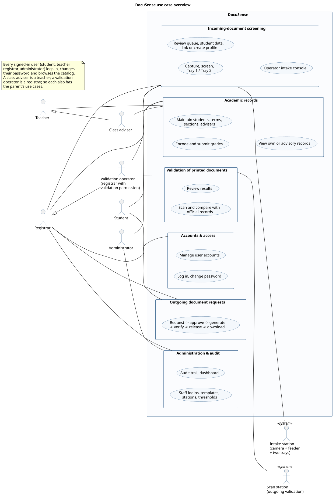

| | |
| --- | --- |
| 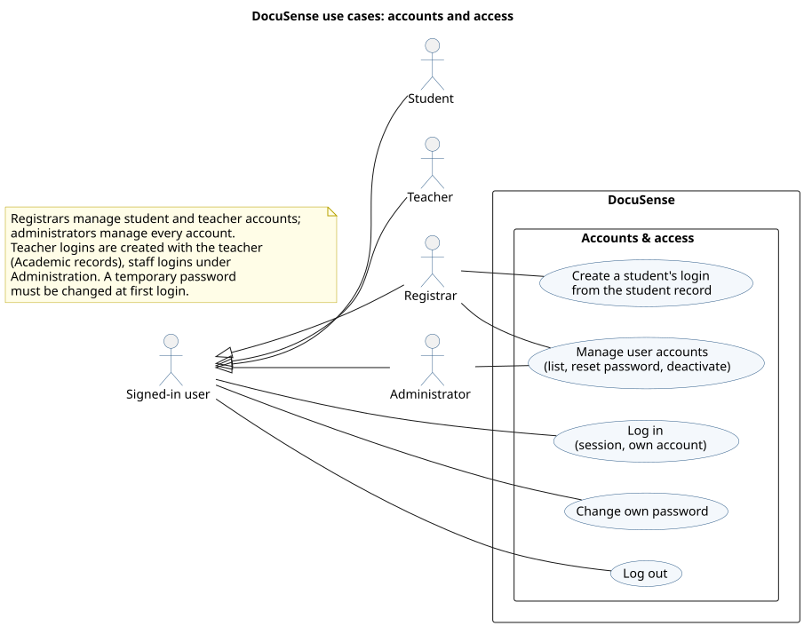 | 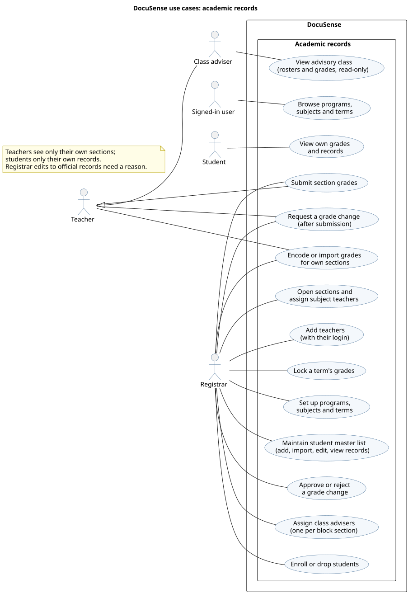 |
| 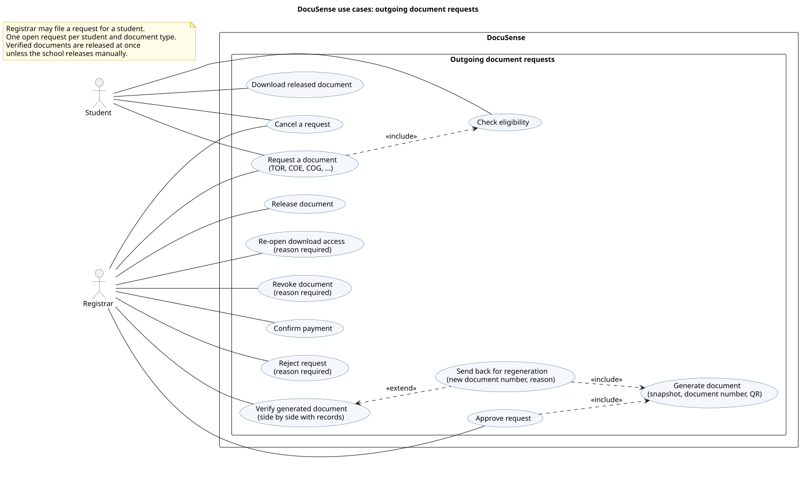 | 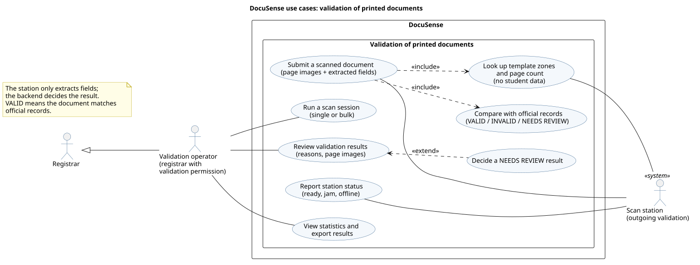 |
| 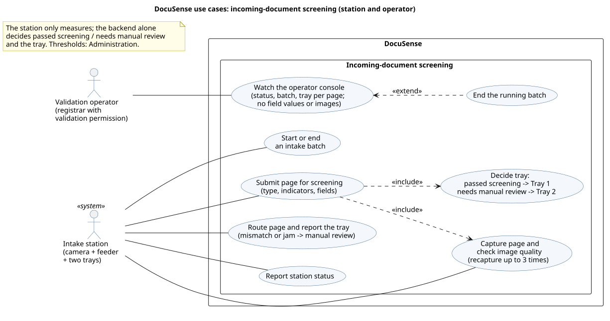 | 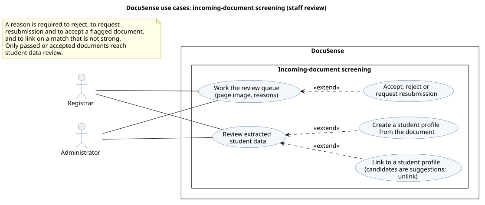 |
| 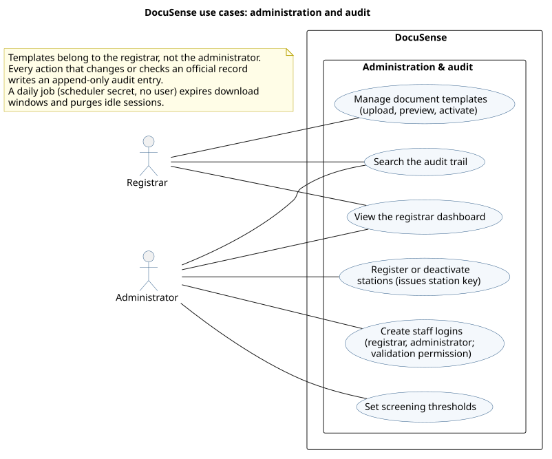 | |

## Class diagrams (Mermaid, generated from the models)

`backend/scripts/gen_class_diagram.py` imports `backend/app/models` and walks
`Base.metadata` and the mapper registry. The overview shows every table and its foreign-key
relationships without attributes; each area diagram shows primary and foreign keys, unique
columns, enum and flag columns and the key business fields, with the enumerations
(`<<enumeration>>`) they use. Classes from other areas are drawn grey and dashed.

Multiplicities come from the foreign keys: the referenced side is `1` (NOT NULL) or `0..1`
(nullable); the referencing side is `0..1` for a unique column, else `*`. Columns that only
record which staff member did something (`created_by`, `reviewed_by`, ...) are left out of the
overview and shown in the area diagrams. Field meanings: [data dictionary](../data-dictionary.md).

<!-- BEGIN generated class diagrams (backend/scripts/gen_class_diagram.py) -->

### Overview (relationships only)

Source [`classes-overview.mmd`](classes-overview.mmd) · exports [SVG](classes-overview.svg), [PNG](classes-overview.png)

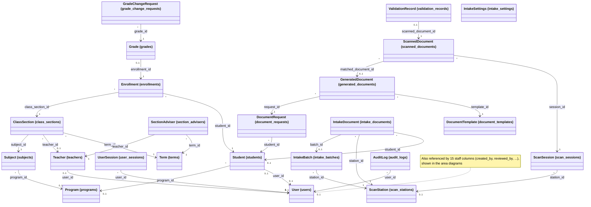

### People and accounts

Source [`classes-people.mmd`](classes-people.mmd) · exports [SVG](classes-people.svg), [PNG](classes-people.png)

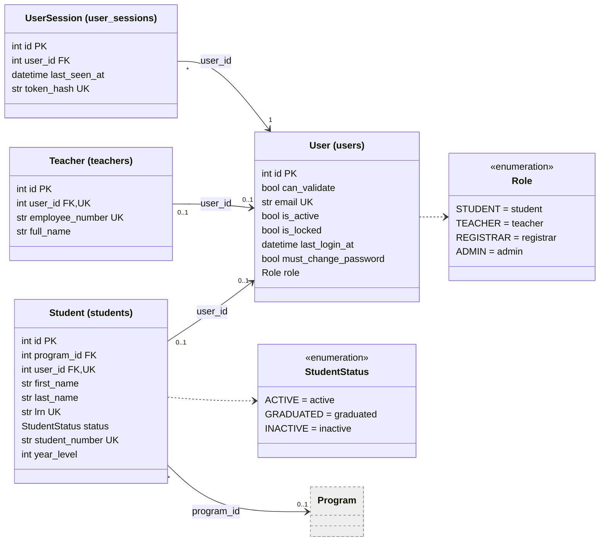

### Academics: programs, subjects, terms, sections, advisers, grades

Source [`classes-academics.mmd`](classes-academics.mmd) · exports [SVG](classes-academics.svg), [PNG](classes-academics.png)

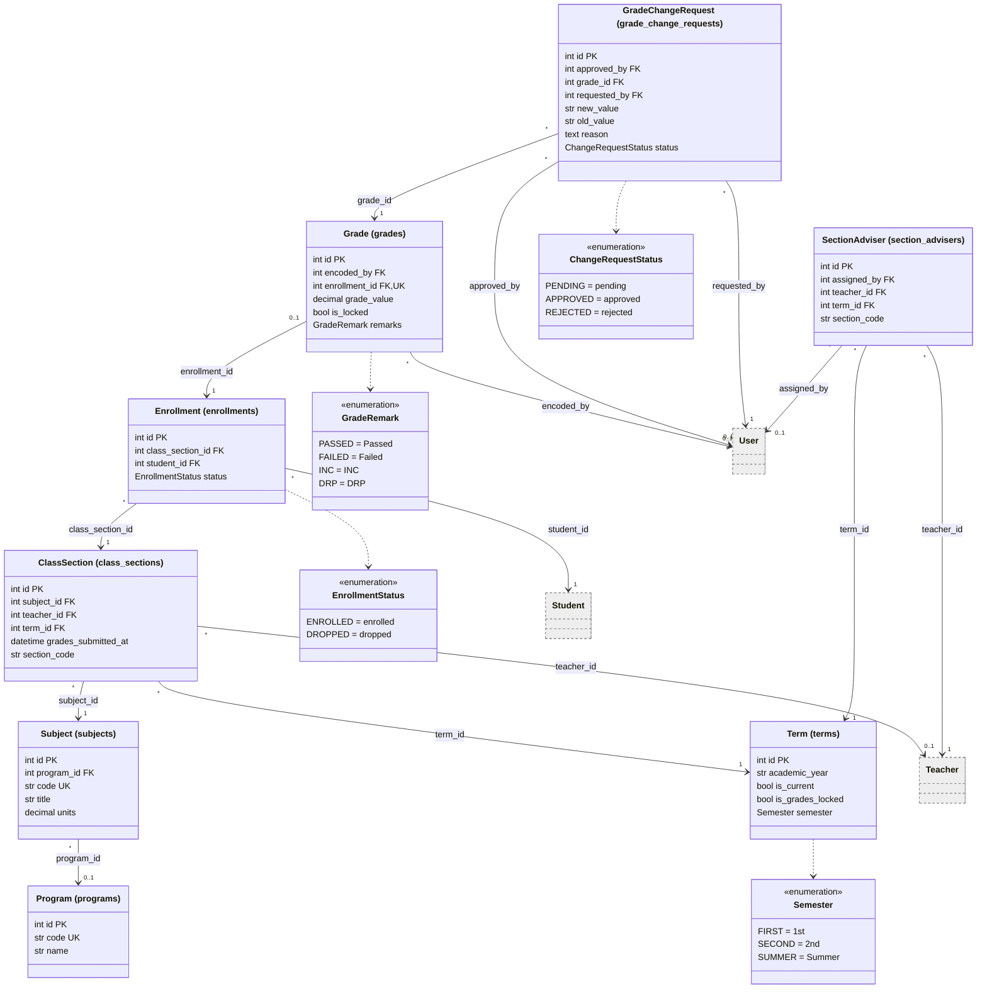

### Requests, generated documents and templates

Source [`classes-documents.mmd`](classes-documents.mmd) · exports [SVG](classes-documents.svg), [PNG](classes-documents.png)

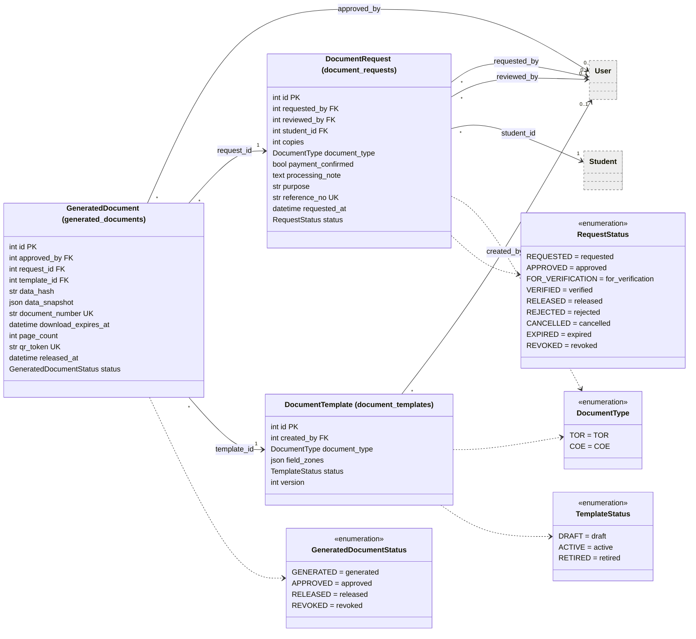

### Validation of printed documents and scan stations

Source [`classes-validation.mmd`](classes-validation.mmd) · exports [SVG](classes-validation.svg), [PNG](classes-validation.png)

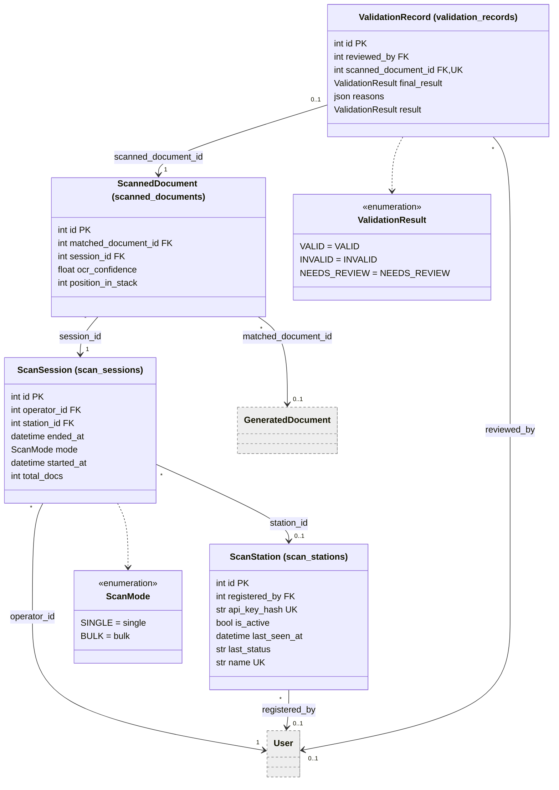

### Incoming-document screening

Source [`classes-intake.mmd`](classes-intake.mmd) · exports [SVG](classes-intake.svg), [PNG](classes-intake.png)

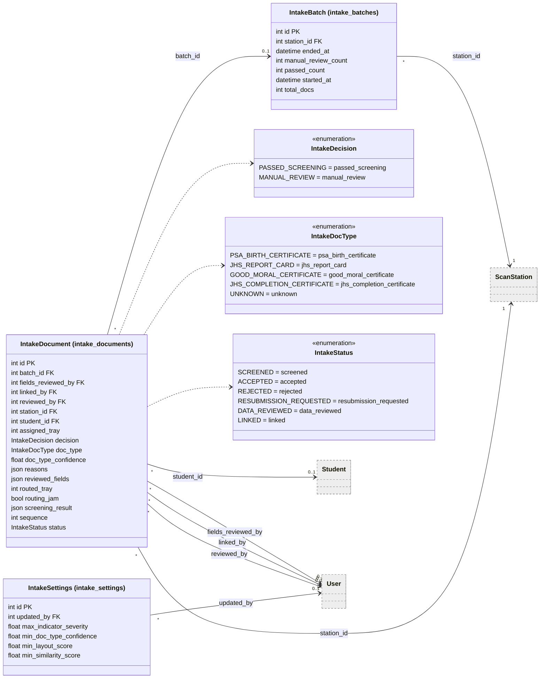

### Audit trail

Source [`classes-audit.mmd`](classes-audit.mmd) · exports [SVG](classes-audit.svg), [PNG](classes-audit.png)

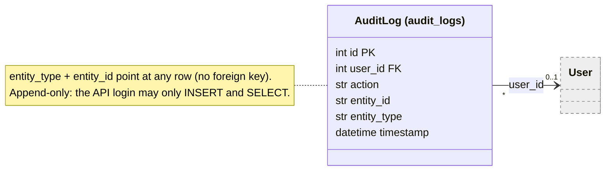

<!-- END generated class diagrams -->
